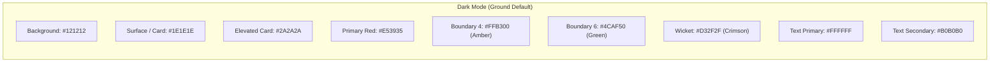
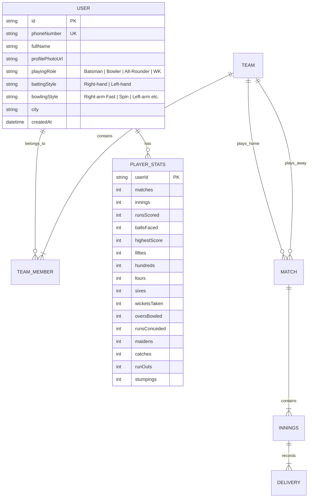

# CricSaga — Design System, Theme Template & Complete Product Specification

**Document Purpose:** Complete specification of theme, UI wireframes, scoring rules, registration flows, and feature boundaries to ensure 100% clarity before any development begins.  
**Target:** CricHeroes competitive parity, zero-learning-curve scoring keypad, uncompromised feature-rich MVP 1.

---

## 1. Complete Design System & Theme Template

The visual identity follows the locked decision: **Red & Charcoal** in dark mode (primary), and **Red & Crisp White** in light mode. Designed for high contrast and readability under direct sunlight on cricket grounds.

### 1.1 Color Palette Specifications



#### Exact Hex Codes

| Token Name | Dark Mode (Primary) | Light Mode | Usage |
| :--- | :--- | :--- | :--- |
| `primary` | `#E53935` (Vibrant Crimson) | `#D32F2F` (Deep Cricket Red) | App bars, primary action buttons, active tabs |
| `onPrimary` | `#FFFFFF` | `#FFFFFF` | Text/icons on primary color |
| `background` | `#121212` (OLED Deep Charcoal) | `#F8F9FA` (Clean Off-White) | Root screen background |
| `surface` | `#1E1E1E` (Dark Slate) | `#FFFFFF` (Pure White) | Scorecards, player cards, dialogs |
| `surfaceVariant`| `#282828` (Elevated Surface)| `#F1F3F4` (Light Grey Surface) | Keypad button background, table headers |
| `textPrimary` | `#FFFFFF` (100% White) | `#1C1B1F` (90% Black) | Runs, player names, primary headers |
| `textSecondary`| `#A0A0A0` (Muted Grey) | `#606060` (Mid Grey) | Over count, economy rate, strike rate |
| `accentFour` | `#FFB300` (Cricket Amber) | `#FF8F00` (Deep Amber) | "4" button & boundary highlights |
| `accentSix` | `#4CAF50` (Boundary Green) | `#2E7D32` (Forest Green) | "6" button & maximum highlights |
| `wicketColor` | `#FF5252` (Alert Coral) | `#D32F2F` (Blood Red) | "Out / Wicket" button & dismissal tags |
| `extraColor` | `#42A5F5` (Umpire Blue) | `#1976D2` (Navy Blue) | Wide, No-ball, Bye, Leg-bye badges |
| `divider` | `#333333` | `#E0E0E0` | Card borders, table dividers |

---

### 1.2 Typography System (Material3)

Using clean, highly legible grotesque sans-serif (system Roboto / Jetpack Compose default) optimized for fast numeric scanning on the pitch:

- **Scoreboard Big Runs:** `FontWeight.ExtraBold`, Size `36sp`, LineHeight `40sp`
- **Player & Bowler Names:** `FontWeight.SemiBold`, Size `16sp`, LineHeight `22sp`
- **Keypad Numbers (`0-6`):** `FontWeight.Bold`, Size `22sp`, LineHeight `26sp`
- **Keypad Extras / Actions (`Wd, Nb, Out`):** `FontWeight.Bold`, Size `15sp`, LineHeight `20sp`
- **Sub-stats (Overs, CRR, RRR):** `FontWeight.Medium`, Size `13sp`, LineHeight `18sp`
- **Timeline Ball Badges:** `FontWeight.Bold`, Size `12sp` centered in circular badges

---

### 1.3 The Scoring Screen Layout (CricHeroes Parity & Muscle Memory)

To guarantee **zero learning curve** for existing CricHeroes scorers, the layout geometry adheres strictly to the field standard:

```
+---------------------------------------------------------+
| [<-] Match: Warriors vs Tigers              (⚙) [Share] |
| 1st Innings • 20 Overs Match • Tennis Ball              |
+---------------------------------------------------------+
|                    WARRIORS INNINGS                     |
|                   142 / 4  (16.3 / 20)                  |
|               CRR: 8.61   •   Projected: 173            |
+---------------------------------------------------------+
| BATSMAN                      R    B   4s   6s     SR    |
| * Rohit Sharma              48   31    5    2  154.8    |
|   Virat Kohli               19   14    2    0  135.7    |
+---------------------------------------------------------+
| BOWLER                       O    M    R    W    ECON   |
|   Jasprit Bumrah           3.3    0   24    2    6.85   |
+---------------------------------------------------------+
| THIS OVER:  [ 1 ]  [ 0 ]  [ 4 ]  [ Wd ]  [ 6 ]  [ W ]   |
+---------------------------------------------------------+
| KEYPAD:                                                 |
| +------------+------------+------------+--------------+ |
| |     0      |     1      |     2      |      3       | |
| +------------+------------+------------+--------------+ |
| |     4      |     6      |    WIDE    |   NO BALL    | |
| |  (Amber)   |  (Green)   |    (Wd)    |     (Nb)     | |
| +------------+------------+------------+--------------+ |
| |    BYE     |  LEG BYE   |   OUT / W  |     UNDO     | |
| |    (B)     |    (Lb)    |   (Crimson)|   (Warning)  | |
| +------------+------------+------------+--------------+ |
| [ 🔄 Rotate Strike ] [ 👥 Bowler ] [ 🛑 Extras / Edit ] |
+---------------------------------------------------------+
```

---

## 2. Complete Cricket Rules & State Machine (MVP 1)

No feature stripping. CricSaga will support full competitive scoring logic from Day 1:

### 2.1 Match Setup Specifications
- **Match Types:** Limited Overs (custom overs from 1 to 50 overs).
- **Ball Types:** Tennis Ball (Light/Heavy), Leather Ball.
- **Toss:** Winner team, Decision (Bat / Bowl).
- **Squad Size:** Flexible (6 to 15 players per team).
- **Match Controls:**
  - Max overs per bowler limit (e.g. `Overs / 5`, rounded up, or custom limit).
  - LBW toggle: Disabled by default for Tennis ball matches, enabled for Leather.
  - Wide runs: 1 run + re-ball (default).
  - No-ball runs: 1 run + re-ball + Free Hit toggle.

### 2.2 Complete Dismissal Modal (Fielder Attribution)
When `OUT / W` is pressed, a dialog opens requiring complete details:
1. **Dismissal Mode:**
   - **Bowled:** Credited to bowler. Batsman out.
   - **Caught:** Credited to bowler. Requires selecting **Fielder (Catcher)** from fielding squad.
   - **Caught Behind:** Credited to bowler. Fielder auto-set to Wicketkeeper.
   - **Caught & Bowled:** Credited to bowler (bowler is catcher).
   - **Run Out:** NOT credited to bowler. Requires:
     - Which batsman is out (Striker vs Non-striker)?
     - Runs completed before run out (0, 1, 2, 3)?
     - Fielder 1 (Thrower) & Optional Fielder 2 (Catcher/Stumper).
   - **Stumped:** Credited to bowler. Requires selecting Wicketkeeper.
   - **Hit Wicket:** Credited to bowler.
   - **LBW:** Credited to bowler (only if LBW enabled for match).
   - **Retired Hurt / Retired Out:** Not credited to bowler.
2. **Next Batsman Selection:** Select incoming batsman from batting team squad.
3. **Strike Position:** Confirm who is on strike for the next delivery.

### 2.3 Delivery Resolution & Event Stack
Every delivery records:
- `ballId` (UUID)
- `overNumber`, `ballInOver` (legal ball 1..6)
- `strikerId`, `nonStrikerId`, `bowlerId`
- `runsOffBat` (0, 1, 2, 3, 4, 5, 6)
- `extraType` (None, Wide, NoBall, Bye, LegBye, Penalty)
- `extraRuns` (0, 1, 2, etc.)
- `isLegalDelivery` (False for Wide/NoBall)
- `wicket` (Full dismissal details if out)
- `timestamp`

#### The Undo Mechanism
- Pressing **UNDO** pops the last delivery off the event stack.
- Recalculates striker, non-striker, bowler figures, over count, and partnership instantaneously.
- Can be executed repeatedly back to the beginning of the match.

---

## 3. Complete User Registration & Profile Schema

No throwaway guest accounts. Every player has a verified profile for career stat tracking:



---

## 4. Free vs. Premium (₹99/Month) Feature Boundaries

| Feature | **Free Tier** | **Premium Tier (₹99/mo)** |
| :--- | :---: | :---: |
| **User Registration & Profile** | Full | Full |
| **Team Creation & Rosters** | Unlimited | Unlimited |
| **Match Setup & Ball-by-Ball Scoring** | Unlimited | Unlimited |
| **Live Match Sharing (Web View via WhatsApp)**| Unlimited | Unlimited |
| **Basic Scorecards (Batting, Bowling, FOW)** | Unlimited | Unlimited |
| **Basic Career Stats (Runs, Wickets, Matches)** | Included | Included |
| **Historical Scorecard Screenshot OCR Importer** | 1 Trial Match | **Unlimited Import** |
| **Wagon Wheels & Spider Charts** | Locked | **Unlocked** |
| **Manhattan & Worm Graphs** | Locked | **Unlocked** |
| **PDF Scorecard Export** | Watermarked | **Clean Pro PDF Export** |
| **WhatsApp Match Highlight Poster Maker** | Locked | **Unlocked** |
| **Ad-Free Experience** | Guaranteed 100% Ad-Free | Guaranteed 100% Ad-Free |

---

## 5. Offline-First Synchronization & Conflict Rules

1. **Local-First Authority:** The Android device storing the match is the absolute single source of truth during live play. Every delivery is committed to local SQLite (Room) before any network dispatch.
2. **Single Scorer Lock:** The match creator (or delegated scorer) owns write permissions. Network requests carry a sequential `deliveryIndex` and match ID.
3. **Idempotent API Sync:** If connectivity drops, WorkManager queues deliveries. The backend processes deliveries idempotently using `(matchId, deliveryIndex)` unique constraint. Retries never duplicate runs or wickets.
