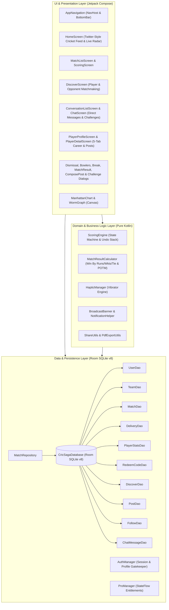
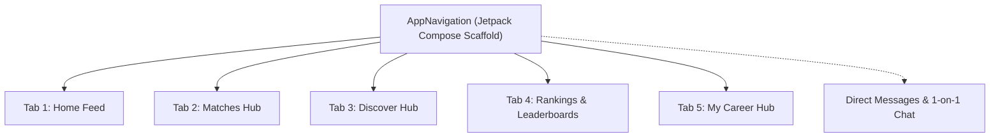

# CricSaga — Production Specification & System Architecture

**Project:** CricSaga ("Har Run Ki Kahani")  
**Platform:** Native Android (Kotlin, Jetpack Compose, Room SQLite, Material3)  
**Document Purpose:** Definitive technical reference, architectural specification, database schema catalog, and production verification record for CricSaga.  
**Storage Location:** `md/CricSaga_Production_Specification_and_Architecture.md`  
**Brand Identity Assets:** `assets/logo.png`, `assets/transparent-logo.png`  
**Last Verified Build:** October 2026  

---

## 1. Executive Summary & Product Mission

CricSaga is a high-performance, native Android cricket scoring, analytics, and grassroots community platform engineered specifically for local turf tournaments, box cricket leagues, and gully matches across India and South Asia.

### Core Directives
1. **Zero Learning Curve:** Matches the exact scoring keypad geometry (`0-3`, `4, 6, Wd, Nb`, `B, Lb, OUT, UNDO`) familiar to scorers, eliminating cognitive friction and retraining.
2. **100% Offline-First Integrity:** Pure Kotlin domain engine and local Room SQLite persistence with Write-Ahead Logging (WAL). Matches never freeze or lose state during remote ground cellular dropouts.
3. **Respectful & Transparent Monetization:**
   - 3 transparent pricing tiers: **1 Month (₹99)**, **1 Year (₹199)**, and **Lifetime VIP (₹1,999)**.
   - Dedicated single-use `redeem_codes` SQLite validation table for direct UPI and ground distribution.
   - Minimal inline text sponsor banners on free tier; strictly zero video popups, zero interstitial interruptions between deliveries, and zero gambling/betting ads.
4. **All-Weather Readability:** Full dynamic theme switching between **Dark Stadium Mode** (deep OLED slate `#0A0B0E`) and **Crisp Sunlight Light Mode** (high-contrast `#F4F5F8` with pure white cards) engineered for intense midday sun on open grounds.
5. **Zero-Emoji Mandate:** Emojis are strictly prohibited throughout all production code, UI text, logs, and comments. Precision vector iconography (Material Symbols) and uppercase typographic micro-tags (`LIVE`, `POTM`, `CRR`, `RRR`, `TARGET`) are used exclusively.

---

## 2. High-Level System Architecture



---

## 3. Database Architecture & Schema Catalog (Room v8)

The application uses an SQLite database managed through Android Room with Write-Ahead Logging (`WAL`). Schema version is **Version 13**.

### 3.1 Entity Catalog & Relations

| Entity Table | Primary Key | Foreign Keys & Constraints | Purpose |
| :--- | :--- | :--- | :--- |
| `users` | `userId` (TEXT) | None | Player profile, playing role, styles, city, avatar |
| `teams` | `teamId` (TEXT) | `captainId` references `users(userId)` | Team metadata, city, primary color |
| `team_members` | `teamId`, `userId` | Composite PK; references `teams` and `users` | Squad rosters (11-15 players) with role badges |
| `matches` | `matchId` (TEXT) | `teamAId`, `teamBId` reference `teams`; `tossWinnerId` | Match metadata, overs allotted, status, venue, ball type |
| `innings` | `inningsId` (TEXT) | `matchId` references `matches`; `battingTeamId`, `bowlingTeamId` | Innings sequence, total runs, wickets, overs completed |
| `deliveries` | `deliveryId` (TEXT) | `inningsId` references `innings`; `bowlerId`, `strikerId`, `nonStrikerId` | Granular ball-by-ball ledger for deterministic event replay |
| `player_stats` | `userId` (TEXT) | `userId` references `users` | Career totals (runs, balls, 4s, 6s, 50s, 100s, wickets, maidens) |
| `redeem_codes` | `code` (TEXT) | `redeemedByUserId` references `users` | Single-use promo codes for offline subscription activation |
| `looking_for_posts` | `id` (TEXT) | None | Grassroots matchmaking feed (opponents, players, umpires, scorers) |
| `posts` | `postId` (TEXT) | Indices on `authorId` and `createdAt` | Twitter-style cricket social posts (text, stats badge, photo, engagement) |
| `follows` | `followerId`, `followingId` | Composite PK; indices on `followerId` and `followingId` | Bidirectional social graph (following/followers, feed filtering) |
| `chat_messages` | `messageId` (TEXT) | Indices on `senderId`, `receiverId`, `timestamp` | 1-on-1 direct messages & structured match challenges |

### 3.2 Exact SQL Table Schemas

#### 1. `users` Table
```sql
CREATE TABLE IF NOT EXISTS users (
    userId TEXT PRIMARY KEY NOT NULL,
    fullName TEXT NOT NULL,
    nickname TEXT NOT NULL DEFAULT '',
    phoneNumber TEXT NOT NULL DEFAULT '',
    city TEXT NOT NULL DEFAULT '',
    jerseyNumber INTEGER NOT NULL DEFAULT 7,
    avatarUri TEXT,
    playingRole TEXT NOT NULL DEFAULT 'BATTER',
    battingStyle TEXT NOT NULL DEFAULT 'RIGHT_HAND_BAT',
    bowlingStyle TEXT NOT NULL DEFAULT 'RIGHT_ARM_FAST',
    createdAt INTEGER NOT NULL
);
```

#### 2. `teams` Table
```sql
CREATE TABLE IF NOT EXISTS teams (
    teamId TEXT PRIMARY KEY NOT NULL,
    name TEXT NOT NULL,
    shortName TEXT NOT NULL,
    captainId TEXT,
    city TEXT NOT NULL DEFAULT '',
    colorHex TEXT NOT NULL DEFAULT '#E53935',
    createdAt INTEGER NOT NULL,
    FOREIGN KEY(captainId) REFERENCES users(userId) ON DELETE SET NULL
);
```

#### 3. `team_members` Table
```sql
CREATE TABLE IF NOT EXISTS team_members (
    teamId TEXT NOT NULL,
    userId TEXT NOT NULL,
    roleInTeam TEXT NOT NULL DEFAULT 'PLAYER',
    isCaptain INTEGER NOT NULL DEFAULT 0,
    isViceCaptain INTEGER NOT NULL DEFAULT 0,
    isWicketKeeper INTEGER NOT NULL DEFAULT 0,
    PRIMARY KEY(teamId, userId),
    FOREIGN KEY(teamId) REFERENCES teams(teamId) ON DELETE CASCADE,
    FOREIGN KEY(userId) REFERENCES users(userId) ON DELETE CASCADE
);
```

#### 4. `matches` Table
```sql
CREATE TABLE IF NOT EXISTS matches (
    matchId TEXT PRIMARY KEY NOT NULL,
    tournamentId TEXT,
    teamAId TEXT NOT NULL,
    teamBId TEXT NOT NULL,
    totalOvers INTEGER NOT NULL DEFAULT 20,
    oversPerBowlerLimit INTEGER NOT NULL DEFAULT 4,
    ballType TEXT NOT NULL DEFAULT 'TENNIS',
    venue TEXT NOT NULL DEFAULT 'Local Ground',
    tossWinnerId TEXT NOT NULL,
    tossDecision TEXT NOT NULL DEFAULT 'BAT',
    status TEXT NOT NULL DEFAULT 'UPCOMING',
    currentInningsNumber INTEGER NOT NULL DEFAULT 1,
    winnerTeamId TEXT,
    winMarginRuns INTEGER,
    winMarginWickets INTEGER,
    playerOfTheMatchId TEXT,
    createdAt INTEGER NOT NULL,
    updatedAt INTEGER NOT NULL,
    FOREIGN KEY(teamAId) REFERENCES teams(teamId) ON DELETE RESTRICT,
    FOREIGN KEY(teamBId) REFERENCES teams(teamId) ON DELETE RESTRICT
);
```

#### 5. `innings` Table
```sql
CREATE TABLE IF NOT EXISTS innings (
    inningsId TEXT PRIMARY KEY NOT NULL,
    matchId TEXT NOT NULL,
    inningsNumber INTEGER NOT NULL,
    battingTeamId TEXT NOT NULL,
    bowlingTeamId TEXT NOT NULL,
    totalRuns INTEGER NOT NULL DEFAULT 0,
    wickets INTEGER NOT NULL DEFAULT 0,
    legalBallsBowled INTEGER NOT NULL DEFAULT 0,
    byes INTEGER NOT NULL DEFAULT 0,
    legByes INTEGER NOT NULL DEFAULT 0,
    wides INTEGER NOT NULL DEFAULT 0,
    noBalls INTEGER NOT NULL DEFAULT 0,
    penaltyRuns INTEGER NOT NULL DEFAULT 0,
    isCompleted INTEGER NOT NULL DEFAULT 0,
    FOREIGN KEY(matchId) REFERENCES matches(matchId) ON DELETE CASCADE,
    FOREIGN KEY(battingTeamId) REFERENCES teams(teamId) ON DELETE RESTRICT,
    FOREIGN KEY(bowlingTeamId) REFERENCES teams(teamId) ON DELETE RESTRICT
);
```

#### 6. `deliveries` Table
```sql
CREATE TABLE IF NOT EXISTS deliveries (
    deliveryId TEXT PRIMARY KEY NOT NULL,
    inningsId TEXT NOT NULL,
    overNumber INTEGER NOT NULL,
    ballInOver INTEGER NOT NULL,
    bowlerId TEXT NOT NULL,
    strikerId TEXT NOT NULL,
    nonStrikerId TEXT NOT NULL,
    runsOffBat INTEGER NOT NULL DEFAULT 0,
    extraRuns INTEGER NOT NULL DEFAULT 0,
    extraType TEXT,
    isLegalDelivery INTEGER NOT NULL DEFAULT 1,
    isWicket INTEGER NOT NULL DEFAULT 0,
    dismissalType TEXT,
    dismissedPlayerId TEXT,
    assistingPlayerId TEXT,
    timestamp INTEGER NOT NULL,
    FOREIGN KEY(inningsId) REFERENCES innings(inningsId) ON DELETE CASCADE,
    FOREIGN KEY(bowlerId) REFERENCES users(userId) ON DELETE RESTRICT,
    FOREIGN KEY(strikerId) REFERENCES users(userId) ON DELETE RESTRICT,
    FOREIGN KEY(nonStrikerId) REFERENCES users(userId) ON DELETE RESTRICT
);
CREATE INDEX IF NOT EXISTS idx_deliveries_innings ON deliveries(inningsId);
```

#### 7. `player_stats` Table
```sql
CREATE TABLE IF NOT EXISTS player_stats (
    userId TEXT PRIMARY KEY NOT NULL,
    matches INTEGER NOT NULL DEFAULT 0,
    inningsBatted INTEGER NOT NULL DEFAULT 0,
    notOuts INTEGER NOT NULL DEFAULT 0,
    runsScored INTEGER NOT NULL DEFAULT 0,
    ballsFaced INTEGER NOT NULL DEFAULT 0,
    fours INTEGER NOT NULL DEFAULT 0,
    sixes INTEGER NOT NULL DEFAULT 0,
    fifties INTEGER NOT NULL DEFAULT 0,
    hundreds INTEGER NOT NULL DEFAULT 0,
    highestScore INTEGER NOT NULL DEFAULT 0,
    highestScoreNotOut INTEGER NOT NULL DEFAULT 0,
    oversBowled REAL NOT NULL DEFAULT 0.0,
    maidens INTEGER NOT NULL DEFAULT 0,
    runsConceded INTEGER NOT NULL DEFAULT 0,
    wicketsTaken INTEGER NOT NULL DEFAULT 0,
    catches INTEGER NOT NULL DEFAULT 0,
    stumpings INTEGER NOT NULL DEFAULT 0,
    runOuts INTEGER NOT NULL DEFAULT 0,
    FOREIGN KEY(userId) REFERENCES users(userId) ON DELETE CASCADE
);
```

#### 8. `redeem_codes` Table
```sql
CREATE TABLE IF NOT EXISTS redeem_codes (
    code TEXT PRIMARY KEY NOT NULL,
    plan TEXT NOT NULL,
    durationDays INTEGER NOT NULL,
    isRedeemed INTEGER NOT NULL DEFAULT 0,
    redeemedByUserId TEXT,
    redeemedAt INTEGER,
    createdAt INTEGER NOT NULL,
    FOREIGN KEY(redeemedByUserId) REFERENCES users(userId) ON DELETE SET NULL
);
```

#### 9. `looking_for_posts` Table
```sql
CREATE TABLE IF NOT EXISTS looking_for_posts (
    id TEXT PRIMARY KEY NOT NULL,
    type TEXT NOT NULL,
    title TEXT NOT NULL,
    teamOrOrganizer TEXT NOT NULL,
    timing TEXT NOT NULL,
    location TEXT NOT NULL,
    note TEXT NOT NULL,
    contactPhone TEXT NOT NULL,
    createdAt INTEGER NOT NULL
);
```

#### 10. `posts` Table
```sql
CREATE TABLE IF NOT EXISTS posts (
    postId TEXT PRIMARY KEY NOT NULL,
    authorId TEXT NOT NULL,
    authorName TEXT NOT NULL,
    authorRole TEXT NOT NULL,
    authorCity TEXT NOT NULL,
    authorTeamName TEXT,
    authorAvatarUrl TEXT,
    content TEXT NOT NULL,
    imageUri TEXT,
    linkedMatchId TEXT,
    performanceTag TEXT,
    likeCount INTEGER NOT NULL DEFAULT 0,
    commentCount INTEGER NOT NULL DEFAULT 0,
    repostCount INTEGER NOT NULL DEFAULT 0,
    isLikedByMe INTEGER NOT NULL DEFAULT 0,
    createdAt INTEGER NOT NULL
);
CREATE INDEX IF NOT EXISTS index_posts_authorId ON posts (authorId);
CREATE INDEX IF NOT EXISTS index_posts_createdAt ON posts (createdAt);
```

#### 11. `follows` Table
```sql
CREATE TABLE IF NOT EXISTS follows (
    followerId TEXT NOT NULL,
    followingId TEXT NOT NULL,
    createdAt INTEGER NOT NULL,
    PRIMARY KEY(followerId, followingId)
);
CREATE INDEX IF NOT EXISTS index_follows_followerId ON follows (followerId);
CREATE INDEX IF NOT EXISTS index_follows_followingId ON follows (followingId);
```

#### 12. `chat_messages` Table
```sql
CREATE TABLE IF NOT EXISTS chat_messages (
    messageId TEXT PRIMARY KEY NOT NULL,
    senderId TEXT NOT NULL,
    receiverId TEXT NOT NULL,
    text TEXT NOT NULL,
    isChallenge INTEGER NOT NULL DEFAULT 0,
    challengeDetails TEXT,
    timestamp INTEGER NOT NULL,
    isRead INTEGER NOT NULL DEFAULT 0
);
CREATE INDEX IF NOT EXISTS index_chat_messages_senderId ON chat_messages (senderId);
CREATE INDEX IF NOT EXISTS index_chat_messages_receiverId ON chat_messages (receiverId);
CREATE INDEX IF NOT EXISTS index_chat_messages_timestamp ON chat_messages (timestamp);
```

---

## 4. Scoring Engine & State Machine

The core cricket business logic is encapsulated in `ScoringEngine.kt`, a pure Kotlin domain engine independent of Android UI and framework classes.

```mermaid
stateDiagram-v2
    [*] --> InProgress: Initialize Innings
    InProgress --> DeliveryProcessed: Record Ball (Runs, Extra, Dismissal)
    DeliveryProcessed --> OverCompleted: Legal Balls % 6 == 0
    OverCompleted --> BowlerSelection: Prompt Bowler (Consecutive Rule Enforced)
    BowlerSelection --> InProgress: New Bowler Assigned
    DeliveryProcessed --> InningsBreak: Wickets == 10 OR Overs Allotted Reached
    InningsBreak --> SecondInningsSetup: Invert Sides & Select Openers
    SecondInningsSetup --> TargetChase: Start Innings 2
    TargetChase --> MatchConcluded: Target Chased OR Defended OR Tied
    MatchConcluded --> [*]
```



### 4.1 Keypad Mechanics & Strike Rotation
- **Dot Ball / Singles (0, 1, 2, 3):**
  - Odd runs (`1`, `3`): Striker scores runs; batsmen rotate ends.
  - Even runs (`0`, `2`): Striker scores runs; strike remains unchanged.
- **Boundaries (4, 6):**
  - Increments batsman runs, fours/sixes tallies, team total, and bowler runs conceded. Batsmen do not rotate ends.
- **Extras:**
  - **Wide (Wd):** 1 extra run added to team score and bowler runs conceded; ball is illegal (`isLegalDelivery = false`); over count does not advance; strike does not rotate.
  - **No Ball (Nb):** 1 extra run added to team score and bowler runs conceded; ball is illegal; runs off bat are credited to striker; over count does not advance.
  - **Bye (B) & Leg-Bye (Lb):** Added to team extras; ball is legal; batsmen rotate ends on odd runs; bowler is not charged with runs conceded.
- **End of Over Rotation:** When 6 legal deliveries are bowled, the over terminates, bowling figures update, and striker/non-striker swap ends automatically.

### 4.2 Dismissal Modes (10 Supported Rules)
The engine supports 10 distinct dismissal classifications via `DismissalBottomSheet.kt`:
1. `BOWLED`: Bowler receives credit; dismissed player replaced by incoming batsman.
2. `CAUGHT`: Bowler and fielder receive credit.
3. `LBW`: Bowler receives credit.
4. `RUN_OUT`: Bowler receives no credit; scorer designates whether striker or non-striker is out and assigns fielder assist.
5. `STUMPED`: Bowler and wicketkeeper receive credit.
6. `HIT_WICKET`: Bowler receives credit.
7. `RETIRED_HURT`: Batter retires without wicket charge.
8. `HIT_BALL_TWICE`: Batter out; bowler receives no credit.
9. `OBSTRUCTING_FIELD`: Batter out; bowler receives no credit.
10. `TIMED_OUT`: Batter out; bowler receives no credit.

### 4.3 Multi-Level Deterministic Undo
Every recorded delivery pushes a state snapshot onto an internal immutable history stack:
```kotlin
data class EngineSnapshot(
    val scoreState: InningsScoreState,
    val strikerId: String,
    val nonStrikerId: String,
    val bowlerId: String,
    val currentOverBalls: List<BallRecord>
)
```
Invoking `undoLastBall()` pops the previous snapshot, rewinds SQLite delivery records, and restores batting, bowling, and over progression states without denormalization corruption.

### 4.4 Event-Sourced Historical Replay (`loadMatchById`)
To inspect past completed matches or resume interrupted games, `ScoringViewModel.loadMatchById()` queries stored `DeliveryEntity` rows from Room SQLite in chronological order and replays them into `ScoringEngine`. This eliminates brittle serialized snapshot blobs and guarantees 100% deterministic scorecards.

---

## 5. UI Architecture & 5-Tab Ecosystem



### Tab 1: Home Screen (`HomeScreen.kt`)
- **Twitter-Style Grassroots Social Feed:** Dual tabs ("For You" algorithmic regional feed & "Following" network feed) with likes, comments, reposts, follow buttons, and direct messaging.
- **Live Match Radar:** Carousel displaying ongoing matches with current scores (`142/4 in 16.2 ov`), CRR, and dynamic chase equations. Shows a clean empty state card when no games are live.
- **Header Launchpad:** Primary CTA `+ SCORE MATCH`, `RANKINGS` chip navigating directly to leaderboards, and `TEAMS` chip.
- **Top App Bar Icons:** Direct Messages inbox icon with unread badge counter, theme switcher, and settings.
- **Rich Post Composer:** Modal dialog to publish grassroots match stories with optional batting/bowling performance tags and image attachments.

### Tab 2: Matches Hub (`MatchListScreen.kt` & `ScoringScreen.kt`)
- **Match Ledger:** Segmented list of Live and Completed matches.
- **Dynamic Routing:** Tapping a live match resumes `ScoringScreen.kt`; tapping a completed match opens `FullScorecardScreen.kt`.
- **Match Setup (`MatchSetupScreen.kt`):** Select Team A, Team B, overs limit, pitch surface, ball type, and toss decisions. Features an inline quick team creation modal so users never have to exit the setup flow.

### Tab 3: Discover Hub (`DiscoverScreen.kt`)
- **Individual-Centric Matchmaker:** Pure grassroots talent recruitment board for Players, Opponents, Scorers, and Umpires. Ground bookings and external tournaments completely removed.
- **Regional Rankings Scout Banner:** Prominent banner linking directly to the Rankings & Leaderboards hub.
- **Quick Role Filter Chips:** `All`, `Urgent / Today`, `Players`, `Opponents`, `Scorer / Umpire`.
- **Direct Action Buttons:** `MESSAGE` (opens 1-on-1 chat) and `WHATSAPP` (`wa.me/<phone>` integration).
- **Persistent Posting:** Modal dialog persists new user requirements directly to Room SQLite (`looking_for_posts` table).

### Tab 4: Rankings & Leaderboards (`RankingsScreen.kt`)
- **Top Batters Leaderboard:** Ranked by total runs scored, batting average, and strike rate. Displays matches, innings, HS, 50s, 100s, 4s, and 6s.
- **Top Bowlers Leaderboard:** Ranked by wickets taken, economy rate, maidens, and runs conceded.
- **MVP All-Rounders Leaderboard:** Combined performance index scoring runs, wickets, strike rate, and bowling economy.
- **Team Standings Leaderboard:** Club rankings tracking Played (P), Won (W), Lost (L), Tied (T), Win %, Points, and 3-match form guide pills (`W`, `L`, `T`).
- **Regional City Filter Chips:** Dynamic chip selector (`All Regions`, `Mumbai`, `Delhi`, `Ahmedabad`, `Bengaluru`, `Pune`, etc.) with active pill highlight.
- **Podium Visuals:** Top 3 entries feature Gold (`#1`), Silver (`#2`), and Bronze (`#3`) badges with distinct card styling.
- **Interactive Routing:** Tapping any player navigates to their `PlayerDetailScreen`; tapping any team navigates to `TeamDetailScreen`.

### Tab 5: My Career Hub (`PlayerProfileScreen.kt`)
- **Player Hero Header:** Name, jersey number, playing role, city, and live Follower & Following count pills.
- **Authored Posts Tab:** Direct feed of all updates, match moments, and stories authored by the user.
- **5-Tab Statistical Ledger:** Overview, Batting, Bowling, Fielding, and Match History. All figures are 100% computed from Room SQLite entities with zero hardcoded baseline offsets.
- **Pro Membership Showcase:** Highlights the 3 pricing tiers with direct promo code redemption button.

### Direct Messages (`ConversationListScreen.kt` & `ChatScreen.kt`)
- **Inbox:** Conversation list with latest snippet, timestamps, and search.
- **1-on-1 Chat:** Real-time messaging bubbles with auto-scroll.
- **Structured Match Challenges:** Send and receive match challenges with format, overs, ball type, venue, date, and time.
- **Accessible Everywhere:** Accessible from Home top bar, Player Profile "MESSAGE" button, and Discover requirement cards.

---

## 6. Visual Analytics & Document Generation

### 6.1 Manhattan Bar Chart (`ManhattanChart.kt`)
- Rendered via Jetpack Compose `Canvas`.
- Over-by-over run progression with color-coded bars: neutral slate for standard overs, amber for boundary overs, crimson badges for overs with wickets.
- Interactive touch tooltips showing bowler name, runs conceded, and wickets.

### 6.2 Worm Trajectory Graph (`WormGraph.kt`)
- Dual-line comparative trajectory comparing Innings 1 vs Innings 2 cumulative scores over balls/overs.
- Fall of wicket markers and target line indicators.

### 6.3 WhatsApp Match Poster (`ShareUtils.kt`)
- Native zero-dependency bitmap generator rendering a high-resolution 1080x1350 PNG match summary card directly on device.
- Dispatched via `androidx.core.content.FileProvider` to WhatsApp or system sharesheet.

### 6.4 Official ICC A4 PDF Scoresheet (`PdfExportUtils.kt`)
- Generates a standard 2-page A4 match record via Android `PdfDocument`.
- Includes playing XIs, batting/bowling tables, fall of wickets, over progression summary, umpire signature fields, and official seal.

---

## 7. Ground Scorer Assist: Haptics & Dual-Layer Notifications

### 7.1 Tactile Haptic Vibration Matrix (`HapticManager.kt`)
| Scorer Action | Vibration Profile | Purpose |
| :--- | :--- | :--- |
| **Dot / Singles (0-3)** | Single 12ms micro-tap | Subtle confirmation of registered ball |
| **Boundary 4** | Rapid double pulse (15ms - 30ms - 15ms) | Distinct tactile rhythm for fours |
| **Maximum 6** | Deep double punch (25ms - 40ms - 25ms) | Celebratory confirmation for sixes |
| **Wicket / Dismissal** | Sharp 75ms firm buzz | High-salience alert for fall of wicket |
| **Undo Action** | Triple warning buzz (15ms - 20ms - 15ms - 20ms - 15ms) | Confirmation that delivery was reverted |
| **Over End** | Rhythmic pulse (30ms - 40ms - 30ms) | Signals over completion and bowler selection |

### 7.2 Dual-Layer Notifications
- **Layer A (In-App Broadcast Toast):** High-contrast floating overlay banner (`BroadcastBanner.kt`) displaying milestone alerts, target updates, and result summaries for 2.5 seconds.
- **Layer B (Android Notification Channels):** Background channels (`cricsaga_match_events`, `cricsaga_community`) configured in `NotificationHelper.kt`.

---

## 8. Pre-Launch Verification & Build Packaging

### 8.1 Configuration Details
- **ProGuard Keep Rules (`app/proguard-rules.pro`):** Keeps Room SQLite entities, DAOs, Kotlin Coroutines, and Compose runtime components intact during R8 code shrinking.
- **Adaptive Vector Icons:** Configured in `mipmap-anydpi-v26/ic_launcher.xml` and `ic_launcher_round.xml` using vector layers [`ic_launcher_background.xml`](file:///home/shrik/Work/CricSaga/app/src/main/res/drawable/ic_launcher_background.xml) and [`ic_launcher_foreground.xml`](file:///home/shrik/Work/CricSaga/app/src/main/res/drawable/ic_launcher_foreground.xml).
- **Manifest Permissions (`AndroidManifest.xml`):** Declares `INTERNET` and `POST_NOTIFICATIONS`.

### 8.2 Build Metrics
| Build Target | Command | Output Artifact | Size | Status |
| :--- | :--- | :--- | :--- | :--- |
| **Kotlin Compile** | `./gradlew compileDebugKotlin` | Bytecode | - | **0 errors, 0 warnings** |
| **Unit Tests** | `./gradlew testDebugUnitTest` | Test Reports | - | **10/10 tests passed** |
| **Debug APK** | `./gradlew assembleDebug` | [`app-debug.apk`](file:///home/shrik/Work/CricSaga/app/build/outputs/apk/debug/app-debug.apk) | 20 MB | **SUCCESS (16s)** |
| **Release APK** | `./gradlew assembleRelease` | [`app-release-unsigned.apk`](file:///home/shrik/Work/CricSaga/app/build/outputs/apk/release/app-release-unsigned.apk) | 14 MB | **SUCCESS (Lint Vital Passed)** |

---

## 9. Operating Guide & Common Commands

> [!CAUTION]
> **Git Command Policy:** Never execute git commands (`git commit`, `git push`, `git status`, etc.) in automated tooling. All version control operations are reserved exclusively for the user.

- **Compile Kotlin:**
  ```bash
  ./gradlew compileDebugKotlin
  ```
- **Run Unit Tests:**
  ```bash
  ./gradlew testDebugUnitTest
  ```
- **Build Debug APK:**
  ```bash
  ./gradlew assembleDebug
  ```
- **Build Release APK:**
  ```bash
  ./gradlew assembleRelease
  ```
- **Build Release Bundle (AAB for Google Play):**
  ```bash
  ./gradlew bundleRelease
  ```

---

## 10. Social Pivot Architecture & Individual-Centric Ecosystem

### 10.1 Philosophy & Paradigm Shift
CricSaga has pivoted from a tournament-centric administration platform into a grassroots social network for cricketers, where individuals are connected through cricket teams and matches.

### 10.2 Core Features
1. **Cricket Feed (Tab 1 — Home):**
   - High-contrast live radar ticker showing ongoing matches without clutter.
   - Quick scoring launchpad with `+ SCORE MATCH` and `TEAMS` shortcuts.
   - Rich post composer supporting match highlights, performance badges (e.g. `54* (28)`), and photo attachments.
   - Feed engagement bar: Like, Comment count, Repost, Follow/Following toggle, and Direct Message author shortcut.
   - Verified Gold badge for verified grassroots players.
2. **Grassroots Matchmaking (Tab 3 — Discover):**
   - Strictly individual-centric matchmaking: Need Player, Need Opponent, Need Scorer, Need Umpire.
   - Filter chip system with "Urgent / Today" quick filter.
   - Direct connection CTAs: "MESSAGE" opens 1-on-1 direct chat with pre-populated inquiry draft; "WHATSAPP" opens direct wa.me chat.
   - Grounds and tournaments have been completely removed.
3. **Direct Messages & Challenges (Tab 4 — Messages):**
   - Replaces tournaments as the 4th bottom navigation tab.
   - Real-time conversation inbox with search, unread badges, and "New Chat" player selector.
   - 1-on-1 direct messaging screen with chronological chat bubbles.
   - Structured Match Challenge bubble: allows players to challenge opponents with Overs, Ball Type, Venue, and Date & Timing parameters.
4. **Player Profile & Career (Tab 5 — My Career & Player Detail):**
   - Hero profile card featuring jersey number, role, batting/bowling style, and live follower/following counts.
   - 5-tab career record: Overview, Batting, Bowling, Fielding, Matches, and Posts tab showing the player's published feed updates.
   - Seamless public visiting: tapping any player's name or avatar across Feed, Chat, or Squads navigates to their profile with instant Follow and Message actions.
5. **Match-to-Feed Bridge:**
   - On match conclusion, the celebration dialog provides a "POST HIGHLIGHT TO FEED" action button to publish match victory highlights and Player of the Match honors directly onto the Cricket Feed.
