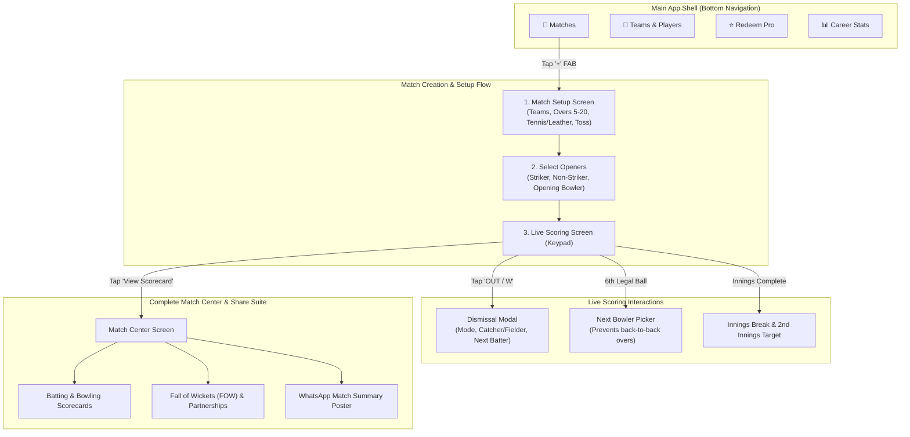

# Unified Implementation Plan — Stages 2 & 3: Complete Android UI, Scoring Lifecycle & Feature Suite

## Goal Description

Deliver the complete, production-ready Android user interface and local match lifecycle for CricSaga before touching backend and cloud sync. 

This unified plan integrates **Stage 2** (Match Setup, Toss, Dismissals, and Bowler Management) and **Stage 3** (Complete Scorecards, Fall of Wickets, Partnerships, WhatsApp Match Posters, Teams & Rosters, and Pro Redeem Codes) into a single, cohesive client experience.

When this plan is executed, CricSaga will be a fully functional, self-contained offline cricket scoring application on your physical Android phone with zero compromises.

---

## User Review Required

> [!IMPORTANT]
> **Complete Offline-First Client:**
> Every feature in this plan operates 100% offline using your local Room SQLite database. Scorers on the pitch can create tournaments/matches, manage squads, score full matches with complete dismissals, view full scorecards, and generate WhatsApp graphics with zero internet connectivity.

> [!TIP]
> **Redeem Code Verification Model:**
> To eliminate 3rd-party gateway fees in initial days as decided, the Pro Redeem Screen verifies codes using an offline cryptographic signature / hash pattern (e.g., `CRIC-PRO-2026`, `PRO-SAGA-TURF`), instantly unlocking the Pro badge and premium scorecard exports locally.

---

## User Journey & App Architecture



---

## Proposed Changes Grouped by Feature Layer

---

### Component 1: Root Navigation & App Shell (`app/src/main/java/com/cricsaga/app/ui/navigation/`)

#### [NEW] `Screen.kt`
- Sealed class defining all top-level destinations and sub-routes:
  - `Matches` (Route: `matches`)
  - `Teams` (Route: `teams`)
  - `RedeemPro` (Route: `redeem_pro`)
  - `Stats` (Route: `stats`)
  - `MatchSetup` (Route: `match_setup`)
  - `OpenersSelection` (Route: `openers_selection/{matchId}`)
  - `LiveScoring` (Route: `live_scoring/{matchId}/{inningsId}`)
  - `FullScorecard` (Route: `full_scorecard/{matchId}`)

#### [NEW] `AppNavigation.kt` & `BottomNavBar.kt`
- Scaffold wrapping the bottom navigation bar with custom CricSaga Dark Theme styling.
- Smooth transitions between tabs with state preservation.

---

### Component 2: Match Setup, Toss & Openers (`app/src/main/java/com/cricsaga/app/ui/setup/`)

#### [NEW] `MatchSetupScreen.kt`
- Form fields with high-contrast Material3 cards:
  - Team A & Team B name selectors (with autocomplete from existing Room teams).
  - Overs preset chips: `5`, `8`, `10`, `12`, `15`, `20`, or Custom overs.
  - Ball Type selector: `Tennis Ball (Light/Heavy)` or `Leather Ball`.
  - Toss Winner radio group (`Team A` or `Team B`).
  - Toss Decision chips (`Elected to BAT` or `Elected to BOWL`).
  - Action button: `Confirm & Select Openers`.

#### [NEW] `OpenersSelectionScreen.kt`
- Displays batting team squad and bowling team squad:
  - Select Striker (from batting team).
  - Select Non-Striker (from batting team).
  - Select Opening Bowler (from bowling team).
  - Action button: `Start Match Scoring`.

---

### Component 3: Live Scoring Modals & Bowler Transitions (`app/src/main/java/com/cricsaga/app/ui/scoring/dialog/`)

#### [NEW] `DismissalBottomSheet.kt` (CricHeroes Parity)
- Modal Bottom Sheet opened when `OUT / W` is tapped:
  - Dismissal Type chips: `Caught`, `Bowled`, `Run Out`, `Stumped`, `LBW`, `Hit Wicket`, `Retired Hurt`.
  - Fielder Attribution:
    - If `Caught`: Dropdown to select Catcher from fielding squad.
    - If `Run Out`: Radio group for who is out (`Striker` vs `Non-Striker`), runs completed (`0, 1, 2, 3`), and thrower/stumper fielder selection.
    - If `Stumped`: Auto-selects Wicketkeeper.
  - Incoming Batsman: Displays available bench players from batting squad.
  - Action button: `Confirm Wicket`.

#### [NEW] `BowlerSelectionDialog.kt`
- Triggered automatically upon the 6th legal delivery of an over:
  - Lists bowling squad players.
  - Disables the bowler who just finished (enforcing cricket's rule against consecutive overs).
  - Allows selecting the next bowler and resumes scoring immediately.

#### [NEW] `InningsBreakDialog.kt`
- Triggered when 1st innings is completed (all overs bowled or all out):
  - Displays 1st innings score summary (`142 / 6 in 20.0 overs`).
  - Displays Target (`Target: 143 runs from 120 balls`).
  - Prompts to select 2nd innings Openers (Striker, Non-Striker, Bowler) and start the chase.

---

### Component 4: Complete Scorecards & Match Center (`app/src/main/java/com/cricsaga/app/ui/scorecard/`)

#### [NEW] `FullScorecardScreen.kt`
- Tabbed Match Center:
  - **Tab 1: Scorecard (Batting & Bowling):**
    - Batting Table: Batter name, dismissal tag (e.g., `c Surya b Bumrah`, `not out`), Runs, Balls, 4s, 6s, Strike Rate.
    - Extras breakdown: Total extras, Wides, No-balls, Byes, Leg-byes.
    - Total: Runs, Wickets, Overs, Run Rate.
    - Bowling Table: Bowler name, Overs, Maidens, Runs, Wickets, Economy.
  - **Tab 2: Fall of Wickets (FOW):**
    - Chronological list: `1-24 (Rohit Sharma, 3.2 ov)`, `2-68 (Virat Kohli, 8.4 ov)`, etc.
  - **Tab 3: Partnerships:**
    - Visual bar charts showing runs contributed by each batter per partnership.
  - **Tab 4: Match Summary & MVP:**
    - Result banner (`Warriors won by 14 runs`).
    - Top Performer cards (Best Batter, Best Bowler).

#### [NEW] `WhatsAppPosterCard.kt`
- A dedicated, high-contrast graphic card component styled for WhatsApp status:
  - Big CricSaga header ("Har Run Ki Kahani").
  - Final Scores: `WARRIORS 164/5 (20) vs TIGERS 150/8 (20)`.
  - Match Result & Player of the Match.
  - Share button to capture and share directly to WhatsApp.

---

### Component 5: Teams, Players & Pro Redeem Screens (`app/src/main/java/com/cricsaga/app/ui/`)

#### [NEW] `TeamsListScreen.kt` & `CreateTeamDialog.kt`
- View all local teams stored in Room.
- Create new team: Team Name, Short Code, City.
- Add squad players: Full Name, Playing Role (Batsman, Bowler, All-Rounder, WK), Batting Style (Right/Left), Bowling Style.

#### [NEW] `RedeemCodeScreen.kt`
- Gold & Crimson Pro membership showcase.
- Input box with uppercase formatting (`CRIC-PRO-2026`).
- Instant unlock animation: changes user status from "FREE" to "PRO MEMBER (Active)".
- Unlocks Pro PDF Scorecard export and Pro badge across all match screens.

---

### Component 6: Room Database & Engine Enhancements

#### [MODIFY] `CricSagaDatabase.kt` & DAOs
- Add queries for multiple matches, recent match history, and active innings transitions.

#### [MODIFY] `ScoringEngine.kt`
- Add 2nd innings target chase logic (checking target reached, balls remaining, win conditions).

---

## Verification Plan

### 1. Automated Unit Tests
- Add unit tests in `ScoringEngineTest.kt` verifying:
  - 2nd innings target chase completion (`targetReachedWinsMatch`).
  - All out termination (`allOutTerminatesInnings`).
  - Bowler restriction enforcement (`consecutiveBowlerRestriction`).
- Run via terminal:
  ```bash
  ./gradlew testDebugUnitTest
  ```
  *Expected:* All tests pass 100% green.

### 2. Physical Phone End-to-End Verification
- Build and install debug APK on physical phone over Wi-Fi:
  ```bash
  ./gradlew assembleDebug
  adb -s 192.168.1.2:41871 install -r app/build/outputs/apk/debug/app-debug.apk
  ```
- **Live User Flow to Verify on Phone Screen:**
  1. **Matches Tab:** Tap "+ Start Match".
  2. **Match Setup:** Enter "Warriors" vs "Tigers", 5 Overs, Tennis Ball, Toss: Warriors elected to Bat -> Tap Proceed.
  3. **Opener Selection:** Pick Rohit (Striker), Virat (Non-Striker), Bumrah (Bowler) -> Tap Start Match.
  4. **Live Scoring:** Score 6 balls -> verify End-of-Over Bowler Picker appears.
  5. **Dismissal:** Tap `OUT / W` -> verify Dismissal Sheet opens, select Caught by Surya -> verify wicket and new batsman.
  6. **Scorecard View:** Tap "View Scorecard" -> verify Batting, Bowling, and FOW tables render.
  7. **Redeem Pro:** Tap "Redeem Pro" tab -> enter `CRIC-PRO-2026` -> verify Pro Member badge unlocks!

### 3. Git Commit
- Commit clean Stage 2 & 3 baseline to Git repository.
