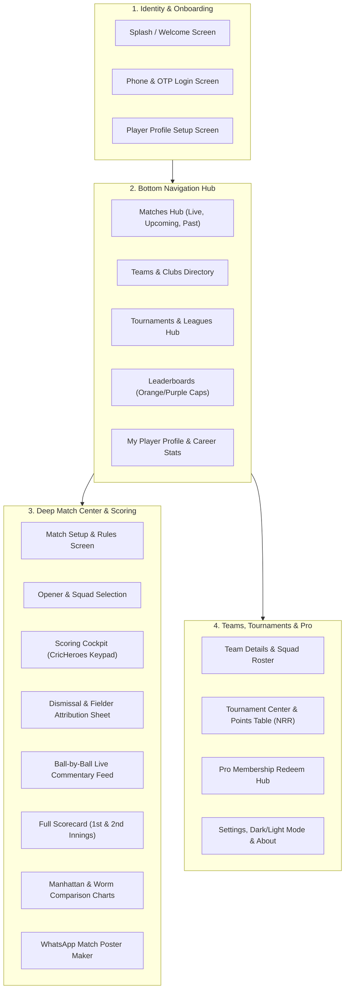

# Complete Screen Inventory & UI Expansion Plan — Full CricHeroes Parity

## Overview

You are 100% right: a minimal shell is not enough to compete with **CricHeroes**. CricHeroes is successful because it feels like an entire cricket universe in your pocket. 

To give players, teams, and tournament organizers a reason to migrate without looking back, we must build out the **complete 18-screen visual ecosystem**.

---

## The Complete Screen Inventory (Grouped by Functional Modules)

---

## Detailed Specifications of the Missing Screens

### Module 1: Identity, Login & Player Setup
1. **Welcome / Splash Screen (`WelcomeScreen.kt`):**
   - High-impact brand hero with CricSaga tagline ("Har Run Ki Kahani").
   - Quick "Get Started" and "Login with Mobile".
2. **Phone Login & OTP Screen (`PhoneAuthScreen.kt`):**
   - Indian mobile number input (`+91`) with clean OTP pin boxes (`_ _ _ _ _ _`).
   - Resend OTP timer.
3. **Player Profile Setup Screen (`ProfileSetupScreen.kt`):**
   - Avatar picker, Full Name, Jersey Number.
   - Playing Role chips (`Batsman`, `Bowler`, `All-Rounder`, `Wicket-Keeper`).
   - Batting Style chips (`Right Hand`, `Left Hand`).
   - Bowling Style chips (`Right-arm Fast`, `Right-arm Spin`, `Left-arm Fast`, etc.).
   - City / Home Ground.

---

### Module 2: Player Career Profile & Records (`PlayerProfileScreen.kt`)
4. **Player Profile & Career Statistics Screen:**
   - Hero header with player avatar, verified badge, Pro star, and primary team.
   - **Tab 1: Career Overview:** Matches, Runs, Wickets, High Score, Best Bowling, Batting Avg, Bowling Economy.
   - **Tab 2: Batting Records:** Matches, Innings, Not Out, Runs, 4s, 6s, 50s, 100s, Strike Rate.
   - **Tab 3: Bowling Records:** Overs, Maidens, Runs Conceded, Wickets, 4-wicket hauls, 5-wicket hauls, Bowling Avg.
   - **Tab 4: Fielding Records:** Catches, Run Outs, Stumpings.
   - **Tab 5: Match History:** List of all matches played with personal score chips (e.g. `48* (31)` or `3/24`).

---

### Module 3: Team Details & Squad Management (`TeamDetailScreen.kt`)
5. **Team Detail & Squad Hub:**
   - Team crest, Short Code, Captain and Vice-Captain badges, City.
   - **Squad List Tab:** All registered players with their role badges and jersey numbers, plus an "+ Add Player to Squad" action.
   - **Team Matches Tab:** Historical results with "WON" (Green) and "LOST" (Red) badges.
   - **Team Statistics Tab:** Matches Played, Win %, Highest Team Total, Lowest Total defended.

---

### Module 4: Deep Match Center & Rich Visual Analytics
6. **Live Ball-by-Ball Commentary Feed (`MatchCommentaryTab.kt`):**
   - Auto-generated cricket commentary for every ball:
     - `14.4: Bumrah to Rohit, 4 RUNS! Cracking pull shot through mid-wicket!`
     - `14.5: Bumrah to Rohit, OUT! Caught by Surya! High in the air and taken safely!`
     - `14.6: Bumrah to Hardik, no run. Defended solidly back to the bowler.`
7. **Manhattan & Worm Comparison Charts (`ManhattanChartTab.kt`):**
   - Bar chart showing runs scored in every individual over.
   - Cumulative "Worm" graph showing Team A's trajectory vs Team B's chase trajectory with wicket dots.
8. **Innings Switcher & Did Not Bat (DNB) List:**
   - Seamlessly toggle between "Warriors 1st Innings" and "Tigers 2nd Innings".
   - Shows "Did Not Bat" players at the bottom of the scorecard.

---

### Module 5: Tournaments, Points Table & Leaderboards
9. **Tournament Hub Screen (`TournamentListScreen.kt`):**
   - List of tournaments (e.g. "Mumbai Monsoon Cup 2026", "Sunday Turf League").
10. **Tournament Detail & Points Table (`PointsTableScreen.kt`):**
    - The classic league table:
      | Pos | Team | P | W | L | PTS | NRR |
      | :--- | :--- | :---: | :---: | :---: | :---: | :---: |
      | 1 | Warriors | 5 | 4 | 1 | 8 | +1.240 |
      | 2 | Tigers | 5 | 3 | 2 | 6 | +0.410 |
11. **Leaderboards Screen (`LeaderboardScreen.kt`):**
    - **Orange Cap (Top Batsmen):** Ranked by total runs, average, and strike rate.
    - **Purple Cap (Top Bowlers):** Ranked by total wickets and economy rate.
    - **Most Sixes Leaderboard.**

---

### Module 6: Settings & Appearance (`SettingsScreen.kt`)
12. **Settings Screen:**
    - App Theme toggle (OLED Dark Mode vs Pitch Light Mode).
    - Scoring Sound Effects (Haptic feedback / beep on boundary).
    - About CricSaga, Version info, and Social links.

---

## Proposed Implementation Phasing

To deliver all these screens cleanly without overwhelming your system:

- **Batch 1 (Immediate):**
  1. Complete Player Profile Screen (Career Stats: Batting, Bowling, Fielding, Match History).
  2. Team Detail Screen (Squad Roster, Team Win/Loss Stats, Captain badges).
  3. Live Ball-by-Ball Commentary Feed Tab in Match Center.
  4. Innings Switcher (1st Innings vs 2nd Innings) & Did Not Bat (DNB) lists.
  5. Settings & Appearance Screen.

- **Batch 2 (Next):**
  6. Phone Login & OTP Verification Flow.
  7. Tournament Hub, Points Table (NRR calculation) & Leaderboards (Orange/Purple caps).
  8. Manhattan Bar Chart & Worm graph.
