# Comprehensive Design Comparison — CricHeroes vs. CricSaga

**Document Purpose:** In-depth, side-by-side design comparison examining every screen, component, color hierarchy, and user flow in **CricHeroes**, establishing the exact design parity and competitive enhancements for **CricSaga**.

---

## 1. Design System & Visual Identity Comparison

| Design Element | **CricHeroes (Current Market Leader)** | **CricSaga (Our Design System)** | Competitive Reason |
| :--- | :--- | :--- | :--- |
| **Brand Colors** | Forest Green (`#0F5132`), White, Lime Green (`#76BA1B`), Grey borders (`#E0E0E0`). | **OLED Deep Charcoal (`#121212`)**, Slate Cards (`#1E1E1E`), **Vibrant Crimson (`#E53935`)**, Amber (`#FFB300`), Grass Green (`#4CAF50`). | **Sunlight Readability:** Green/white washes out under bright 40°C cricket pitch sunlight. High-contrast OLED Charcoal + Red/Amber remains razor sharp. |
| **Scoring Button Color Coding** | Uniform grey or light green buttons with small text labels. | **Semantic Color Tokens:** • `4` = Cricket Amber (`#FFB300`) • `6` = Maximum Green (`#4CAF50`) • `OUT` = Crimson Alert (`#FF5252`) • Extras = Umpire Blue (`#42A5F5`) | **Zero Cognitive Load:** Scorers make split-second decisions on the ground; color-coding prevents accidental taps. |
| **Ad Experience & Monetization** | **Heavy aggressive ads, unskippable video popups, and betting app ads** (My11Circle, Stake, 1xBet) interrupting scoring. Expensive recurring subscriptions. | **Minimal, Non-Intrusive Ads on Free Tier** (clean inline banners, zero video popups, strictly zero betting ads). **3 Flexible Pro Plans:** • ₹99 for 3 months • ₹199 for 1 year • ₹2,000 for Lifetime • Pro removes 100% of ads. | Scorers and players hate aggressive ads that burn battery and delay matches. CricSaga gives unbeatable value and clean UX. |
| **Typography Scale** | Standard Roboto, often small numeric font sizes (`18sp-22sp` for score). | High-legibility Grotesque sans-serif with **extra-bold score headers (`34sp-38sp`)** and high-contrast numbers. | Instant glancing from the pitch sidelines. |
| **Card Geometry** | Standard material cards with 8dp radius and light elevation shadows. | **Flat elevated surfaces (`#1E1E1E`, `#282828`) with 12dp rounded corners** and crisp 1px borders (`#333333`). | Modern, clean aesthetic matching contemporary sports apps. |

---

## 2. Screen-by-Screen Side-by-Side Comparison

```mermaid
flowchart TD
    subgraph CricHeroes_Layout["CricHeroes Architecture (9 Core Screens)"]
        CH1["1. Home Screen (Ticker, Ads, Feed)"]
        CH2["2. Scoring Cockpit (Keypad, Tables)"]
        CH3["3. Dismissal Sheet (Modes, Catcher)"]
        CH4["4. Match Center (Summary, Scorecard, Charts)"]
        CH5["5. Player Profile (Overview, Bat, Bowl, Field)"]
        CH6["6. Team Profile (Squad, Matches, Stats)"]
        CH7["7. Tournaments (Points Table, NRR, Caps)"]
        CH8["8. Discover (Looking For, Grounds, Turfs)"]
        CH9["9. Pro Upgrade & Settings"]
    end

    subgraph CricSaga_Parity["CricSaga Full-Parity Equivalent"]
        CS1["1. Clean Home Feed (Live Radar, Highlights)"]
        CS2["2. High-Contrast Scoring Cockpit"]
        CS3["3. Dismissal Sheet + Fielder Attribution"]
        CS4["4. Deep Match Center + WhatsApp Posters"]
        CS5["5. 5-Tab Career Records & Awards Hub"]
        CS6["6. Team & Squad Hub (Crest, Roles, Stats)"]
        CS7["7. Tournament Center (Live NRR Table, Caps)"]
        CS8["8. Discover Hub (Looking For, Grounds Directory)"]
        CS9["9. Direct Redeem Code Hub (CRIC-PRO-2026)"]
    end

    CH1 -.-> CS1
    CH2 -.-> CS2
    CH3 -.-> CS3
    CH4 -.-> CS4
    CH5 -.-> CS5
    CH6 -.-> CS6
    CH7 -.-> CS7
    CH8 -.-> CS8
    CH9 -.-> CS9
```

---

## 3. Microscopic Layout Comparison of the 9 Core Screens

### Screen 1: Home Screen
* **CricHeroes:** Top app bar with Search, Bell, and Profile. Below that is a horizontal carousel of live matches. Then a cluttered feed filled with paid tournament promotions, stories, and sponsored betting ads.
* **CricSaga Design:** 
  - Top Bar: CricSaga logo + Pro status chip + Search icon.
  - **Live Match Radar:** Sleek horizontal cards showing matches currently in progress with live scores, current over, and target chase equation.
  - **Quick Action Strip:** Big "+ Start Match" and "New Tournament" buttons.
  - **Heroes of the Day:** Showcase cards recognizing the century maker, 5-wicket bowler, or top performer in your grassroots community.
  - **Zero Ads:** Clean, uncluttered, battery-saving.

### Screen 2: Scoring Cockpit (On-Ground)
* **CricHeroes:** Score header (`142/4 in 16.3`), Striker & Non-Striker table, Bowler card, over timeline ribbon, 12-button keypad (`0, 1, 2, 3, 4, 6, Wd, Nb, B, Lb, W, Undo`), and quick action buttons.
* **CricSaga Design:** 
  - Exactly preserves the CricHeroes keypad muscle memory (`0-3`, `4, 6, Wd, Nb`, `B, Lb, W, Undo`).
  - Color-codes the boundary buttons (`4`=Amber, `6`=Green) and dismissal button (`OUT`=Coral Red).
  - High-contrast OLED dark cards so the phone stays cool in the sun and battery lasts 8+ hours.
  - Strike rotate button and live Room SQLite persistence indicator.

### Screen 3: Dismissal Modal
* **CricHeroes:** Bottom sheet with 10 dismissal types. Dropdown for fielder selection on Caught/Run Out. Bench picker for incoming batsman.
* **CricSaga Design:** 
  - Complete 10 dismissal modes.
  - Filter chips for fielding squad to assign catchers and run-out assists.
  - Radio buttons to confirm who was dismissed on run outs (Striker vs Non-Striker) and runs completed.
  - Incoming batsman picker from the available bench.

### Screen 4: Match Center & Scorecards
* **CricHeroes:** Tabs for Summary, Scorecard (Innings 1/2), Commentary, Analysis (Wagon wheel, Manhattan, Worm), Heroes, and Match Info. *Note: CricHeroes paywalls Wagon Wheels and watermarks scorecard downloads!*
* **CricSaga Design:**
  - **Tab 1: Scorecard:** Full Batting Table (Runs, Balls, 4s, 6s, SR, dismissal tags), Bowling Table (O, M, R, W, Econ), Extras breakdown, and Did Not Bat (DNB) list.
  - **Tab 2: Fall of Wickets (FOW):** Sequential list of wicket falls (`1-24 Rohit 3.2 ov`).
  - **Tab 3: Ball-by-Ball Auto-Commentary:** Live generated cricket commentary feed for every delivery.
  - **Tab 4: WhatsApp Status Poster:** Instant 1-tap graphic poster with CricSaga branding, final score, and Player of the Match ready for Instagram and WhatsApp status sharing.
  - **Tab 5: Manhattan & Worm Charts:** Visual run rate and chase progression comparisons.

### Screen 5: Player Profile & Career Records
* **CricHeroes:** Hero card with photo, verified badge, and Pro star. Tabs for Overview, Batting, Bowling, Fielding, Matches, and Badges.
* **CricSaga Design:**
  - Complete 5-tab career record suite:
    - *Overview:* Matches, Runs, Wickets, High Score, Best Bowling, Batting Avg, Bowling Economy.
    - *Batting Table:* Matches, Inns, NO, Runs, Highest, Avg, SR, 50s, 100s, 4s, 6s.
    - *Bowling Table:* Overs, Maidens, Runs Conceded, Wickets, Avg, Econ, 4w, 5w.
    - *Fielding Table:* Catches, Run Outs, Stumpings.
    - *Match History:* Chronological list of games with performance chips.

### Screen 6: Team Profile & Squad Roster
* **CricHeroes:** Team crest, short code, city, Captain/Vice-Captain badges. Squad tab, Matches tab, Stats tab.
* **CricSaga Design:**
  - Complete Team Hub: Team crest, Short Code, City, Captain.
  - Squad Roster with player role badges, jersey numbers, and "+ Add Player" flow.
  - Team Match History with `WON` (Green) and `LOST` (Red) result tags.
  - Team Statistics: Matches played, Win %, Highest total, Lowest defended.

### Screen 7: Tournaments & Points Table
* **CricHeroes:** Fixtures schedule, Points Table with Net Run Rate (NRR), Orange Cap, and Purple Cap leaderboards.
* **CricSaga Design:**
  - Tournament Hub: Fixtures, Schedule, Participating Teams.
  - **Live Points Table:** Real Net Run Rate (NRR) calculation formula (`Runs Scored / Overs Faced - Runs Conceded / Overs Bowled`).
  - **Leaderboards:** Orange Cap (Top Batsmen), Purple Cap (Top Bowlers), Maximum Sixes King.

### Screen 8: Discover & "Looking For" Ecosystem
* **CricHeroes:** "Looking for" tab (teams, players, opponents, umpires) and Grounds directory. Marred by paid coin requirements or restricted phone numbers.
* **CricSaga Design:**
  - **Looking For Matchmaker:** Post challenges for weekend opponents, find players for tonight's box match, find umpires/scorers.
  - **Direct WhatsApp Action:** One-tap to WhatsApp the captain or player directly without paying coins or watching video ads.
  - **Grounds & Turfs Directory:** Search local box cricket turfs and grounds with pitch type, floodlights, and direct booking.

### Screen 9: Pro Membership & Settings
* **CricHeroes:** Pushes Google Play recurring billing with 15–30% platform cuts, credit card requirements, and aggressive ad upsells.
* **CricSaga Design:**
  - **Three Flexible Value Plans:**
    1. **₹99 for 3 Months** (Seasonal League pass)
    2. **₹199 for 1 Year** (Annual pass - unbeatable value)
    3. **₹2,000 for Lifetime** (VIP Founder status)
  - **Minimal Ads on Free Tier:** Only clean inline sponsor banners; no video popups, no betting ads.
  - **Direct Redeem Code System:** Enter `CRIC-PRO-2026` or promo codes distributed via direct UPI/cash with **₹0 platform commission**.
  - Instant Gold Pro Member badge.
  - App settings: Dark Mode / Light Mode toggle, haptic feedback toggle, About CricSaga.

---

## 4. The Verdict: We Match 100% and Offer More

By delivering all 9 core screens across the 5 primary tabs (`Home`, `Matches`, `Discover`, `Tournaments`, `Profile`), CricSaga achieves:
1. **100% Feature Parity** with CricHeroes's best features.
2. **Superior Performance:** Native Kotlin + Jetpack Compose + Room SQLite WAL running smoothly on low-end budget phones.
3. **Respect for Players:** Minimal ads for free users (no betting ads, no popups), unbeatable 3-tier Pro pricing (₹99/3mo, ₹199/1yr, ₹2000/life), direct WhatsApp matchmaking, and unwatermarked posters.
