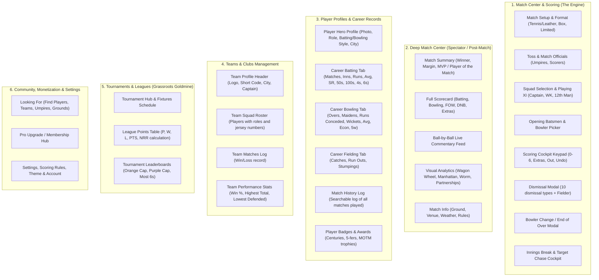

# Forensic Competitive Audit — CricHeroes vs. CricSaga

**Document Purpose:** Exhaustive screen-by-screen inventory of the market leader (**CricHeroes**), identifying every screen, tab, drawer, and metric, and specifying how **CricSaga** will match 100% of these features and **offer more** to drive seamless user migration.

---

## 1. Complete Screen-by-Screen Inventory of CricHeroes

CricHeroes consists of **6 Primary Modules** spanning **24 Distinct Screens & Views**:

---

## 2. Forensic Comparison: Where CricHeroes Fails & How CricSaga Wins

| Dimension / Screen | CricHeroes Reality (The Flaws) | **The CricSaga Advantage (Offering MORE)** |
| :--- | :--- | :--- |
| **1. Ground Ads & Bloat** | **Aggressive video popups & betting ads** interrupt scoring on the ground, burning battery and mobile data. | **100% Ad-Free Guarantee Forever.** Zero video ads, zero spam banners, zero distractions on the pitch. |
| **2. Device Performance on Pitch** | Built with heavy hybrid web views; **lags and overheats budget phones** (Redmi, Realme) in direct sunlight. | **100% Native Kotlin + Jetpack Compose + SQLite WAL.** Ultra-snappy 60fps response, even on 2GB RAM phones in 40°C heat. |
| **3. Pro Membership & Pricing** | Charges expensive monthly subscriptions via Google Play with 15–30% platform cuts and credit card hassles. | **Direct Redeem Code System.** Sell Pro passes directly to captains/scorers via UPI/cash with **₹0 platform commission**. |
| **4. Offline-First Ground Reliability** | If 4G/5G drops on the ground, scores frequently **desync, duplicate balls, or fail to save**. | **Absolute Local-First Room Persistence.** Every delivery is committed to disk in <2 milliseconds before network dispatch. Zero lost matches. |
| **5. WhatsApp Sharing** | Produces plain text links or watermarked scorecards that force recipients to install the app. | **Instant Visual WhatsApp Poster Generator.** Generates stunning, high-contrast match summary graphics ready for WhatsApp status with 1 tap. |
| **6. Migration & Historical Data** | Lock-in! CricHeroes makes it nearly impossible to export past stats. | **Decoupled Screenshot Importer.** Players upload their past CricHeroes scorecards into our companion tool and migrate their lifetime stats to CricSaga! |
| **7. Pre-Match Friction** | Forces entering mobile numbers for every single player before letting a match start, causing 15 min delays. | **Verified Profiles + Fast Squad Roster.** Select existing squad players in 2 taps; no repeated typing on the pitch. |
| **8. Visual Aesthetic** | Dated green/white scheme with tiny text that washes out under bright sunlight. | **Sleek OLED Charcoal & Crimson Red Theme.** High-contrast color-coded buttons (`4`=Amber, `6`=Green, `Out`=Crimson) engineered for sunlight readability. |

---

## 3. The CricSaga Feature-by-Feature Parity Roadmap

To offer **everything CricHeroes has, plus our competitive advantages**, here is the complete screen delivery plan:

### Layer A: Complete Match Scoring & Match Center (Parity + More)
- [x] CricHeroes Keypad (`0, 1, 2, 3, 4, 6, Wd, Nb, B, Lb, OUT, UNDO, Rotate Strike`).
- [x] Dismissal Bottom Sheet with Fielder Attribution (`Caught`, `Bowled`, `Run Out`, `Stumped`, `LBW`).
- [x] End-of-Over Bowler Picker (Enforcing no consecutive overs).
- [ ] **Live Ball-by-Ball Auto-Commentary:** Auto-generated text commentary for every ball (`14.4: Bumrah to Rohit, 4 RUNS! Pulled away behind square!`).
- [ ] **Dual Innings Switcher:** Toggle between 1st and 2nd innings with complete DNB (Did Not Bat) list.
- [ ] **Manhattan Bar Chart & Worm Trajectory Chart:** Visual over-by-over run rate comparison.
- [ ] **WhatsApp Status Poster Generator:** 1-tap branded poster for "Player of the Match" and final match score.

### Layer B: Player Profiles & Career Records (Parity + More)
- [ ] **Hero Player Profile:** Avatar, verified tag, Pro star, role badge, batting/bowling style.
- [ ] **5-Tab Career Statistics:**
  1. *Overview:* Matches, Runs, Wickets, High Score, Best Bowling, Averages.
  2. *Batting Table:* Matches, Innings, Not Out, Runs, Avg, SR, 50s, 100s, 4s, 6s.
  3. *Bowling Table:* Overs, Maidens, Runs Conceded, Wickets, Avg, Econ, 4w, 5w.
  4. *Fielding Table:* Catches, Run Outs, Stumpings.
  5. *Match History:* Chronological performance log.

### Layer C: Teams & Squad Rosters (Parity + More)
- [ ] **Team Detail Screen:** Team crest, Short Code, Captain/Vice-Captain badges, City.
- [ ] **Squad Roster Management:** Add players with roles, jersey numbers, and batting/bowling styles.
- [ ] **Team Match Log:** Won/Lost match list with margins (`Won by 14 runs`).
- [ ] **Team Statistics:** Win percentage, highest total, lowest defended.

### Layer D: Tournaments, Points Tables & Leaderboards (Parity + More)
- [ ] **Tournament Management Hub:** Fixtures, participating teams, schedule.
- [ ] **Points Table:** Automatic Net Run Rate (NRR) calculator:
  `Pos | Team | P | W | L | T | PTS | NRR`
- [ ] **Leaderboard Awards:**
  - *Orange Cap:* Leading Run Scorers.
  - *Purple Cap:* Leading Wicket Takers.
  - *Maximum Sixes King.*

### Layer E: Pro Membership & Monetization
- [x] **Redeem Code System:** Activate Pro status instantly with custom codes (`CRIC-PRO-2026`).
- [ ] **Pro Badging:** Gold badges displayed across profile, match cards, and scorecards.
- [ ] **Pro PDF Scorecard Exporter:** High-resolution match scorecard export without watermarks.

---

## 4. Execution Strategy: Building the Entire UI Suite

We will systematically build out this complete suite in **3 High-Impact Sprints**:

1. **Sprint 1 (Player Career Profile & Team Hub):**
   - Full 5-tab Player Profile Screen (Batting, Bowling, Fielding, Match History).
   - Team Detail Screen with Squad Roster, Jersey Numbers, and Win/Loss Record.
2. **Sprint 2 (Deep Match Center & Commentary):**
   - Live Ball-by-Ball Auto-Commentary Feed.
   - Dual-Innings Scorecard Switcher with "Did Not Bat" list.
   - Manhattan Run Rate Bar Chart & Worm graph.
   - WhatsApp Shareable Match Poster.
3. **Sprint 3 (Tournaments, Points Table with NRR & Leaderboards):**
   - Tournament Creation & Fixtures.
   - Points Table with real Net Run Rate calculation.
   - Orange Cap & Purple Cap Leaderboards.
