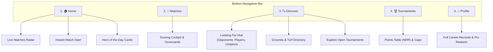

# CricSaga Platform Architecture — Home Feed & Discover Ecosystem Hub

## Overview

You have hit the exact core of what transforms CricSaga from a simple local scoring utility into a **complete cricket network & platform**. 

CricHeroes dominates because it connects the entire cricket community—players looking for teams, teams challenging opponents for weekend matches, organizers finding umpires, and players browsing local box turfs and tournaments.

Here is the complete blueprint for **Home** and **Discover**, showing how CricSaga will match CricHeroes's platform features while eliminating the spam, intrusive video ads, and betting promos that ruin CricHeroes's user experience.

---

## 1. Five-Tab Bottom Navigation Structure

```
+---------------------------------------------------------------------------------+
|  [ 🏠 Home ]   [ 🏏 Matches ]   [ 🔍 Discover ]   [ 🏆 Tournaments ]   [ 👤 Profile ] |
+---------------------------------------------------------------------------------+
```

1. **🏠 Home:** Live Match Ticker, Hero of the Match Highlights, Quick Scorer Launchpad, and Local Match Radar.
2. **🏏 Matches:** Active live scoring cockpit, historical match scorecards, and match setup.
3. **🔍 Discover:** The Grassroots Community Market ("Looking For" players/teams/opponents, Turf & Ground directory, Tournament registrations).
4. **🏆 Tournaments:** Leagues, Cups, Points Tables with live Net Run Rate (NRR), Orange & Purple Cap leaderboards.
5. **👤 Profile / Pro:** Player Career Stats, Team rosters, and Pro Redeem Code activator (`CRIC-PRO-2026`).

---

## 2. Deep Dive: The "Home" Tab (`HomeScreen.kt`)

Unlike CricHeroes—which clutters its Home screen with betting apps and unskippable video ads—CricSaga’s Home screen is a **clean, dynamic cricket command center**.

```
+---------------------------------------------------------+
| (CricSaga Logo)   [🔍 Search]   [⭐ PRO BADGE]    (🔔)   |
+---------------------------------------------------------+
| [🔴 LIVE NOW ON CRICSAGA]                               |
| +-----------------------------------------------------+ |
| | Warriors vs Tigers • 18.2 ov                        | |
| | 154 / 4 (Target 168) • Needs 14 runs in 10 balls    | |
| +-----------------------------------------------------+ |
| +-----------------------------------------------------+ |
| | Sunday Club vs Royal Challengers • 6.4 ov           | |
| | 62 / 1 (CRR: 9.3) • 1st Innings                     | |
| +-----------------------------------------------------+ |
+---------------------------------------------------------+
| [⚡ QUICK ACTIONS]                                      |
| [ 🏏 Start Match ] [ 🏆 New Tournament ] [ 🤝 Challenge]|
+---------------------------------------------------------+
| [🌟 HEROES OF THE WEEK (Grassroots Highlights)]        |
| - Rohit Sharma: 84* (36) - Mumbai Turf Cup              |
| - Jasprit Bumrah: 4/12 (4.0) - Saturday Premier League  |
+---------------------------------------------------------+
| [📅 UPCOMING LOCAL MATCHES & TOURNAMENTS]               |
| - Monsoon Open Trophy • July 15 • Shivaji Park          |
+---------------------------------------------------------+
```

### Key Sections in Home:
1. **Live Match Radar (Horizontal Carousel):**
   - Displays all live matches in your circle/city with real-time ticking scores, overs, CRR, and target chase equation.
   - Tap any card to open the live spectator view.
2. **Quick Launchpad:**
   - Huge, high-contrast **"Start Match"** button for scorers standing on the field.
   - **"Register Tournament"** for organizers.
3. **Grassroots Hero Highlights:**
   - Daily automated recognition cards: "Century Maker of the Day", "5-Wicket Haul Hero", "Player of the Match".
4. **Recent Community Feed:**
   - Completed match results with one-tap WhatsApp status cards.

---

## 3. Deep Dive: The "Discover" Tab (`DiscoverScreen.kt`)

The **Discover** module is the commercial and social engine of grassroots cricket. CricHeroes calls this "Looking For" and charges heavy fees or restricts contacts. CricSaga makes it **free, fast, and community-driven**.

```
+---------------------------------------------------------+
| DISCOVER CRICKET ECOSYSTEM                              |
| [ 🤝 Looking For ]   [ 🏟️ Grounds & Turfs ]   [ 🏆 Tournaments ] |
+---------------------------------------------------------+
```

### Sub-Hub 1: "Looking For" (The Grassroots Matchmaker)
Scorers and team captains frequently face ground crises:
- **"Looking for an Opponent Team":**
  - Example: *"Warriors CC looking for a 20-over leather ball opponent this Sunday (10 AM) at Cross Maidan. We have booked the ground. Contact Captain Rahul."*
- **"Looking for Players":**
  - Example: *"Tigers need 2 middle-order batsmen and 1 wicketkeeper for tonight's 8 PM box cricket turf match in Bandra."*
- **"Looking for a Team":**
  - Example: *"Left-arm orthodox spinner with 4 years club experience looking to join a Saturday league team."*
- **"Looking for Umpires & Scorers":**
  - Example: *"Need 2 qualified umpires for Corporate Trophy semi-finals this weekend. Match fee provided."*

> **CricSaga Advantage:** Tap **"WhatsApp Captain"** or **"Call"** directly without paying coins or watching 30-second video ads!

### Sub-Hub 2: Cricket Grounds & Box Turfs Directory
Grassroots cricket runs on turf bookings (box cricket, turf grounds, stadium nets):
- Search grounds by **Location / City**.
- Filter by:
  - **Pitch Type:** Natural Turf, Matting, Astroturf, Indoor Box Cricket.
  - **Lighting:** Day / Night Floodlights available.
  - **Amenities:** Leather ball permitted, pavilion, water, live-streaming cameras.
- Direct booking / enquiry phone numbers.

### Sub-Hub 3: Tournament Explorer
- Browse upcoming tournaments in your state/city.
- View:
  - Entry Fee & Prize Pool (e.g. ₹5,000 Entry, ₹50,000 Winner).
  - Ball Type (Tennis light/heavy, Leather).
  - Contact Organizer button.

---

## 4. UI Architecture & Screen Map



---

## 5. Execution Strategy

We will implement this expanded ecosystem cleanly:
1. **The 5-Tab Bottom Navigation Bar:** `Home`, `Matches`, `Discover`, `Tournaments`, `Profile`.
2. **`HomeScreen.kt`:** Live Match Radar, Quick Start button, Hero Highlights, and Recent Results.
3. **`DiscoverScreen.kt`:** 
   - Tab 1: **"Looking For" Board** (Filter by Opponent, Players, Umpires with direct WhatsApp action).
   - Tab 2: **"Grounds & Turfs" Directory** (Filter by Astroturf/Box/Natural, Day/Night lights).
   - Tab 3: **"Tournaments Nearby" Explorer**.
4. **`PlayerProfileScreen.kt` & `TournamentDetailScreen.kt`:** Full career records and live Points Table with Net Run Rate.
