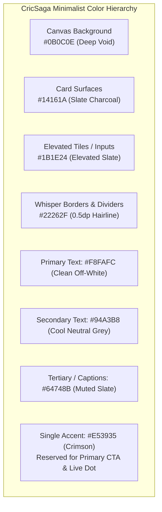

# CricSaga — Professional UI Redesign Strategy & 3-Loop Evaluation

**Document Purpose:** Complete architectural and aesthetic overhaul to transform CricSaga from a colorful, prototype-like app into a sleek, professional, production-grade cricket platform on par with Apple Sports, modern Cricbuzz, Linear, and Strava.  
**Location:** `md/professional_ui_redesign_strategy.md`  
**Date:** 2026-10-20  

---

## Executive Summary & Core Philosophy

Your feedback is exact and uncompromising:
1. **"it does not look professional, it looks like some college project"**
2. **"think about a cleaner design"**
3. **"donot show logo and app branding everywhere"**
4. **"keep the app less colorful"**

To ensure we make the right aesthetic choices with zero backtracking, this document breaks down the redesign across **three rigorous, iterative evaluation loops**.

---

## LOOP 1: Brutal Forensic Audit & Deconstruction
### *What specifically caused the "college project" look?*

| Flaw / Symptom | Why It Looks Amateur | Industry Standard Behavior |
| :--- | :--- | :--- |
| **1. Logo & Branding Overkill** | Plastering the cricket ball logo and `"CRICSAGA - Har Run Ki Kahani"` on every top app bar (Home, Discover, Tournaments, Profile) looks insecure and repetitive. | Top-tier apps (Apple Sports, Spotify, SofaScore, Airbnb) display their logo **only once** (top-left of Home or on Splash). Every other screen has a simple, confident typography header (`Matches`, `Discover`, `Tournaments`, `Profile`). |
| **2. Fruit-Salad Color Explosion** | Competing neon/saturated colors all over the screen: Crimson buttons, Gold/Amber card outlines, bright green badges, orange cap blocks, purple cap blocks, yellow text, and blue extras. | Professional dark-mode design is **90% monochromatic**. Deep blacks, slate cards, and cool neutral greys. Only **one single accent color** (Crimson `#E53935`) is used, and only for primary intent actions (e.g. Strike dot, Start Match). |
| **3. Colored Card Borders** | Wrapping cards in colored 1px borders (`border = SolidColor(BoundaryAmber)` or `CrimsonPrimaryDark`). This is a hallmark of student design projects trying to make cards "pop". | Professional sports cards have **no colored borders**. They rely on subtle tonal elevation (e.g. `#14161A` on `#0B0C0E`) and hairline 0.5px neutral borders (`#22262F`). |
| **4. Metric Box Clutter** | In Player Profile, cramming 12 square colored boxes onto the screen (`TOTAL RUNS` in red, `WICKETS` in amber, `AVG` in white, `50s` in grey). It looks chaotic, crowded, and unreadable. | Elite apps use clean, spacious typography rhythms (e.g. 4 primary hero figures in a clean horizontal strip, followed by clean tabular data rows with right-aligned tabular numerals). |
| **5. Cluttered Pill Badges** | Loud pill badges ("CENTURY MAKER", "FIVE-WICKET HAUL", "OPPONENT", "LIVE", "OPEN") screaming for attention across every list item. | Information hierarchy should be established through **font weight, font size, and subtle opacity**, not glowing rainbow badges. |

---

## LOOP 2: Benchmark Analysis & The Clean Design System
### *How world-class sports & utility apps achieve premium simplicity*

### The Design Pillars
1. **Quiet Authority (Restraint):** Let the cricket data (scores, overs, strike rates, run rates) take center stage. The UI chrome should recede into the background.
2. **Strict Monochromatic Foundation:** 
   - A dark palette built from slate-tinted blacks, not pitch black `#000000` (which causes harsh contrast and eye fatigue) and not murky brown/grey.
3. **Single High-Intent Accent:**
   - Crimson `#E53935` reserved strictly for:
     - The primary "+ Start Match" CTA
     - The live striker indicator dot on the pitch
     - The subtle pulsing live match indicator
   - All other elements (borders, icons, cards, inactive tabs) use neutral tones.

### Exact Token Specification

* **Canvas Background:** `#0B0C0E` (Deep neutral void)
* **Card Surface:** `#14161A` (Clean slate charcoal)
* **Elevated Tile / Input:** `#1B1E24`
* **Subtle Hairline Border:** `#22262F` (0.5dp, strictly neutral)
* **Divider Line:** `#1A1D24` (0.5dp)
* **Text Primary:** `#F8FAFC` (High legibility, zero glare)
* **Text Secondary:** `#94A3B8` (Subtle, balanced)
* **Text Tertiary / Muted:** `#64748B` (Quiet captions)
* **Functional Scoring Accents (Muted & Balanced):**
  - Boundary 4: Clean Amber `#D97706` (Text/icon only, no neon glow)
  - Boundary 6: Clean Green `#16A34A` (Text/icon only)
  - Dismissal / Loss: Clean Red `#DC2626`
  - Win: Clean Subtle Green `#16A34A`

---

## LOOP 3: Screen-by-Screen Component Architecture & Layout Lockdown
### *Detailed plan for every screen to ensure zero backtracking*

### Screen 1: App Navigation & Bottom Bar (`AppNavigation.kt`)
* **Top App Bar Branding Policy:**
  - **`HomeScreen` ONLY:** Displays a small, refined 20dp ball icon + `"CricSaga"` in clean bold typography (`17sp`). No tagline subtitle.
  - **`MatchesScreen`:** Pure typography: `Matches` (`20sp`, Bold, `#F8FAFC`). No logo.
  - **`DiscoverScreen`:** Pure typography: `Discover` (`20sp`, Bold, `#F8FAFC`). No logo.
  - **`TournamentListScreen`:** Pure typography: `Tournaments` (`20sp`, Bold, `#F8FAFC`). No logo.
  - **`PlayerProfileScreen`:** Pure typography: `My Career` (`20sp`, Bold, `#F8FAFC`). No logo.
* **Bottom Bar Navigation:**
  - Flat container `#111317` with hairline top divider `#1E2128`.
  - Inactive icons: Clean cool grey `#64748B`, 20dp.
  - Active icon: Crisp off-white `#F8FAFC` with subtle 4dp indicator bar or subtle crimson tint.
  - Labels: 10sp, clean tracking.

### Screen 2: Home Feed (`HomeScreen.kt`)
* **Header:**
  - Clean top bar: Small logo + `CricSaga`. Right side: A subtle, quiet `PRO` pill or search icon.
* **Live Matches Radar:**
  - Clean section title: `LIVE MATCHES` (11sp, bold, cool grey `#94A3B8`, tracked).
  - Cards: Surface `#14161A`, border `#22262F`.
  - Top row: `Warriors CC vs Royal Tigers` (semi-bold 13sp) + subtle `LIVE` badge (`#DC2626` text on `#1E1414` bg).
  - Middle: Score `142/4` in large bold off-white (`24sp`) + `(16.2 ov)` in grey (`12sp`).
  - Bottom: `Tigers need 28 runs in 22 balls • CRR 8.7` in cool grey.
* **Scorer Launchpad:**
  - Primary button: Solid crimson `#E53935`, 10dp radius: `+ Start New Match`.
  - Secondary tiles: Two clean horizontal tiles (`Teams` and `Tournaments`) in `#1B1E24` with neutral border and off-white text.
* **Top Performers (Clean Sports Card):**
  - Replaces the colorful "HEROES OF THE WEEK" cards with a clean, unified sports card (like SofaScore):
  - Row with circular initials avatar in neutral slate (`RV`, `JK`), player name in semi-bold, match context in muted grey, and performance figures (`104* (48)`) in clean off-white. Zero yellow or red background blobs.
* **Recent Matches:**
  - Clean edge-to-edge list separated by hairline dividers `#1A1D24`.

### Screen 3: Discover Grassroots Hub (`DiscoverScreen.kt`)
* **Header:** Simple, bold `Discover`. No logos.
* **Tabs:** Clean segmented control (`Looking For` | `Grounds & Turfs` | `Tournaments`).
* **"Looking For" Cards:**
  - Clean surface card `#14161A`.
  - Category indicator: Subtle monochrome pill (`Opponent`, `Player`, `Umpire`).
  - Title: Bold off-white (`14sp`).
  - Time & Location: Muted grey with small 12dp neutral icons.
  - Action: Clean button with WhatsApp brand icon, subtle and elegant.
* **Grounds & Turfs:**
  - Clean directory list: Turf name, location (`Andheri West • 1.8 km`), subtle amenities tags (`Astroturf`, `Lights`), pricing `₹900/hr`, rating `4.8 ★`.

### Screen 4: Tournaments Center (`TournamentListScreen.kt`)
* **Header:** Simple, bold `Tournaments`. No logos.
* **Points Table:**
  - Built like an official ICC / Premier League table:
  - Header: `#  TEAM  P  W  L  PTS  NRR` in 10sp bold muted grey `#64748B`.
  - Data rows: Clean, aligned, monospaced tabular numerals.
  - Subtle green vertical bar on top 2 qualification spots instead of full-row colors.
* **Leaderboards:**
  - Replaces the garish bright orange and purple card blocks with clean, elegant dark cards:
  - Header: `Most Runs` (Orange Cap) and `Most Wickets` (Purple Cap) using a subtle 12dp colored dot or icon, not whole neon backgrounds.
  - Clean ranked list with player name, team, and figures.

### Screen 5: Player Profile & Career Hub (`PlayerProfileScreen.kt`)
* **Header:** Simple, bold `My Career`. No logos.
* **Hero Card:**
  - Left: Clean circular avatar with initials.
  - Center: Player name (`Rohit Sharma`) in bold off-white, role (`Top-Order Batsman • Right-Arm Medium`), and city.
  - Status: Discreet pill badge (`Pro Member` with tiny gold star, or `Free Tier`).
* **3 Pro Plans Showcase (When Free):**
  - 3 clean, borderless dark cards:
    - `3 Months`: ₹99
    - `1 Year`: ₹199 (subtle "Best Value" chip)
    - `Lifetime`: ₹2,000
* **Career Stats Summary:**
  - Replaces the 12 loud colored boxes with a sleek 4-metric horizontal hero row:
    - `MATCHES 24` | `RUNS 782` | `WICKETS 14` | `AVG 41.1`
  - Below it: Clean tabular statistical tables for Batting, Bowling, and Fielding with metric name on left and aligned value on right, separated by hairline dividers.

### Screen 6: Pro Redeem Code Screen (`RedeemCodeScreen.kt`)
* **Single tasteful logo** at the top hero card.
* Clean 3 plan selection cards in neutral slate with subtle accent on the annual plan.
* Simple, high-contrast text field with 1-click `Apply Code` action.
* Clean perks checklist and security note.

---

## Comparison Matrix: Before vs. After Redesign

| Screen / Element | Current State (Problematic) | Redesigned State (World-Class Clean) |
| :--- | :--- | :--- |
| **Top App Bars** | Logo + "CRICSAGA" + "Har Run Ki Kahani" on all 5 tabs. | Logo on Home only (20dp). Clean typography headers on all other tabs. |
| **Color Distribution** | Rainbow: Red, yellow, green, orange, purple, blue cards. | 90% Monochromatic Slate/Charcoal. 1 single Crimson accent for primary CTA. |
| **Card Borders** | Loud colored borders (`BoundaryAmber`, `Crimson`). | Borderless or subtle 0.5px neutral borders (`#22262F`). |
| **Profile Stats** | 12 tiny colored square boxes crammed together. | Clean 4-stat hero strip + elegant tabular tables with hairline dividers. |
| **Tournament Caps** | Giant bright orange and purple background blocks. | Clean sports table rows with subtle rank chips. |
| **Overall Aesthetic** | Busy, loud, college-prototype feel. | Minimal, restrained, premium sports utility (Apple Sports / SofaScore level). |

---

## Verification Plan Before Any Code Changes
1. **User Sign-Off:** Review the 3 loops above and confirm this aligns with your exact vision.
2. **Execution Steps:**
   - Step 1: Update design tokens in [`Color.kt`](file:///home/shrik/Work/CricSaga/app/src/main/java/com/cricsaga/app/ui/theme/Color.kt).
   - Step 2: Overhaul top bars across all screens (remove logo spam).
   - Step 3: Refactor Home, Discover, Tournaments, and Profile to the clean monochromatic layout.
   - Step 4: Run `./gradlew testDebugUnitTest assembleDebug`.
   - Step 5: Install on physical phone, capture full-resolution screenshot, and verify the professional aesthetic.
