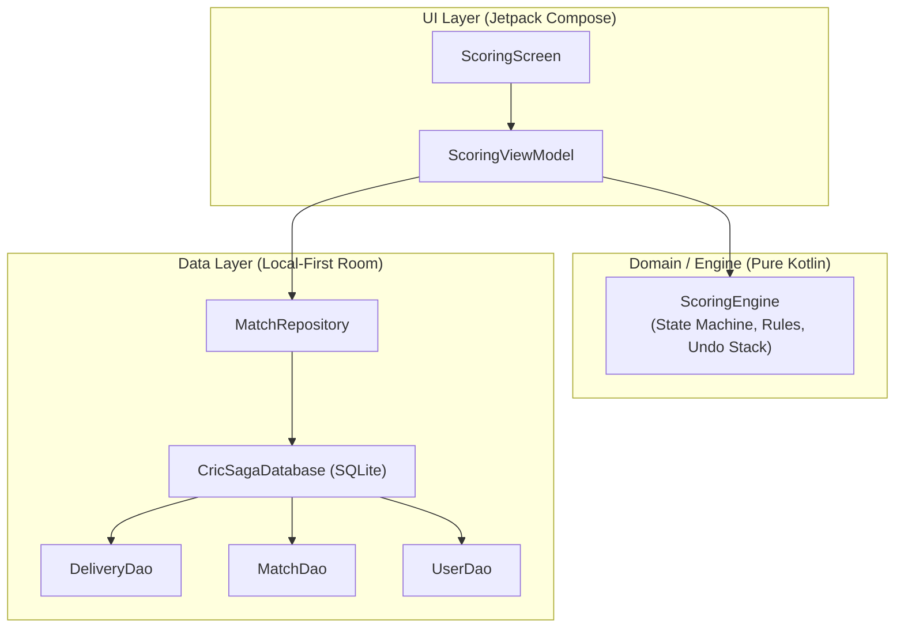

# Implementation Plan — Stage 1: Local-First Android Foundation & Scoring Engine

## Goal Description

Implement the local-first architectural backbone for CricSaga in accordance with `md/CricSaga_Design_System_and_PRD.md` and `md/CricSaga_Decisions_and_Development_Plan.md`. 

This stage establishes:
1. **Local SQLite Persistence via Room:** Complete relational entities and DAOs for offline match storage.
2. **Pure Kotlin Cricket Scoring Engine:** Standalone, deterministic state machine handling legal balls, extras, wickets with fielder attribution, strike rotation, over transitions, and sequential undo.
3. **Automated Unit Test Suite:** High-coverage JVM tests ensuring scoring correctness independently from the UI.
4. **Repository & ViewModel Layer:** Exposing reactive `StateFlow` to Jetpack Compose UI.
5. **Physical Device Verification:** Validating SQLite database operations and scoring live on your phone over Wi-Fi.

---

## User Review Required

> [!IMPORTANT]
> **Pure Kotlin Scoring Engine Independence:**
> As decided in our architecture alignment, the `ScoringEngine` will be implemented in pure Kotlin with **zero Android SDK dependencies** (no `android.*` packages). This makes testing lightning fast (runs in 2 seconds on your i3 CPU without an emulator) and ensures the entire scoring logic is 100% portable if you ever release a Web or iOS version.

> [!NOTE]
> **Room Database Migrations & Versioning:**
> We set up Room database version `1` with type converters for UUIDs, Timestamps, and cricket enumeration types (DismissalType, ExtraType, MatchStatus).

---

## Proposed Changes & File Architecture



---

### Component 1: Build Dependencies (`gradle/libs.versions.toml` & `app/build.gradle.kts`)

#### [MODIFY] `gradle/libs.versions.toml`
- Add Room `2.6.1` and Google KSP (Kotlin Symbol Processing) `2.0.0-1.0.24`.
- Add `androidx-room-runtime`, `androidx-room-ktx`, `androidx-room-compiler`.
- Add `androidx-lifecycle-viewmodel-compose`.

#### [MODIFY] `app/build.gradle.kts`
- Apply `id("com.google.devtools.ksp")`.
- Configure Room dependencies and KSP compiler.

---

### Component 2: Room Data Entities (`app/src/main/java/com/cricsaga/app/data/local/entity/`)

#### [NEW] `UserEntity.kt`
- User/Player profile: `userId` (PK, UUID), `phoneNumber`, `fullName`, `profilePhotoUrl`, `playingRole`, `battingStyle`, `bowlingStyle`, `city`, `createdAt`.

#### [NEW] `TeamEntity.kt` & `TeamMemberEntity.kt`
- `TeamEntity`: `teamId` (PK), `teamName`, `shortCode`, `city`, `captainId`.
- `TeamMemberEntity`: Composite PK `(teamId, userId)`, `jerseyNumber`, `joinedAt`.

#### [NEW] `MatchEntity.kt`
- `matchId` (PK), `matchTitle`, `teamAId`, `teamBId`, `totalOvers`, `ballType` (Tennis/Leather), `tossWinnerTeamId`, `tossDecision` (Bat/Bowl), `maxOversPerBowler`, `isLbwEnabled`, `isFreeHitEnabled`, `matchStatus` (Scheduled/Live/Completed), `winnerTeamId`, `createdAt`.

#### [NEW] `InningsEntity.kt`
- `inningsId` (PK), `matchId` (FK), `inningsNumber` (1 or 2), `battingTeamId`, `bowlingTeamId`, `totalRuns`, `totalWickets`, `totalLegalDeliveries`, `targetRuns`, `isCompleted`.

#### [NEW] `DeliveryEntity.kt`
- Ball-by-ball immutable event record:
  - `deliveryId` (PK, UUID), `inningsId` (FK), `overNumber`, `ballInOver` (1..6)
  - `strikerId`, `nonStrikerId`, `bowlerId`
  - `runsOffBat` (0..6), `extraType` (None/Wide/NoBall/Bye/LegBye), `extraRuns`
  - `isLegalDelivery` (Boolean)
  - Dismissal details: `isWicket`, `dismissalType`, `dismissedPlayerId`, `primaryFielderId`, `secondaryFielderId`
  - `deliveryIndex` (Sequential 1..N per innings for deterministic replay and undo)
  - `timestamp`

#### [NEW] `Converters.kt`
- Room type converters for Enums (`ExtraType`, `DismissalType`, `BallType`, `MatchStatus`) and Timestamps.

---

### Component 3: Room DAOs & Database Singleton (`app/src/main/java/com/cricsaga/app/data/local/`)

#### [NEW] `DeliveryDao.kt`
- `insertDelivery(delivery: DeliveryEntity)`
- `deleteDelivery(deliveryId: String)`
- `getDeliveriesForInnings(inningsId: String): Flow<List<DeliveryEntity>>`
- `getLastDelivery(inningsId: String): DeliveryEntity?`

#### [NEW] `MatchDao.kt` & `InningsDao.kt`
- CRUD operations for matches and active innings with reactive `Flow` queries.

#### [NEW] `CricSagaDatabase.kt`
- RoomDatabase singleton with thread-safe instance provider.

---

### Component 4: Pure Kotlin Cricket Scoring State Machine (`app/src/main/java/com/cricsaga/app/engine/`)

#### [NEW] `ScoringEngine.kt`
Stateful, pure Kotlin scoring engine that processes ball events:
- **`recordDelivery(event: DeliveryInput): ScoringState`**
  - Validates legal delivery vs extras (Wide / No Ball).
  - Updates striker runs & balls faced (except Wides which do not count as balls faced).
  - Updates bowler overs, maidens, runs conceded, and wickets.
  - Updates team total runs and wicket count.
  - Rotates strike based on runs:
    - Odd runs (1, 3, 5): Striker and Non-striker switch ends.
    - Even runs (0, 2, 4, 6): No strike change mid-over.
    - End of over (after 6th legal delivery): Ends switch again.
  - Dismissal resolution:
    - Caught / Bowled / LBW / Stumped: marks batsman out, sets incoming batsman, confirms strike.
    - Run Out: marks specified batsman out (striker or non-striker), adds completed runs, sets strike.
- **`undoLastDelivery(): ScoringState`**
  - Pops the last delivery from the stack.
  - Restores the exact prior match score, batsman figures, bowler figures, and strike rotation.
- **Deterministic State Replay:**
  - Can reconstruct the exact scorecard at any point in time by replaying deliveries from index `1` to `N`.

---

### Component 5: Automated Unit Tests (`app/src/test/java/com/cricsaga/app/engine/ScoringEngineTest.kt`)

#### [NEW] `ScoringEngineTest.kt`
10 unit tests covering core rules and edge cases:
1. `singleRotatesStrike()`: Ball 1 single rotates strike to non-striker.
2. `fourMaintainsStrike()`: Boundary 4 keeps striker on strike.
3. `overCompletionSwitchesStrike()`: Dot ball on ball 6 switches strike for the new over.
4. `oddRunOnLastBallOfOverRetainsStrike()`: Single on ball 6 switches strike twice, meaning the batsman retains strike for the next over.
5. `wideDoesNotIncrementLegalBalls()`: Wide adds 1 run, bowler charged 1 run, ball count remains 0.0, strike unchanged.
6. `noBallAllowsFreeHit()`: No-ball adds extra run, maintains legal ball count.
7. `caughtDismissalCreditsBowlerAndFielder()`: Bowler gets +1 wicket, fielder gets +1 catch, new batsman replaces dismissed player.
8. `runOutDoesNotCreditBowler()`: Bowler wicket count unchanged, completed runs added, correct batsman dismissed.
9. `fullUndoRestoresPreviousScoreAndStrike()`: Pushing deliveries then executing undo returns identical state.
10. `multipleSequentialUndosBackToMatchStart()`: Consecutive undos cleanly unwind an entire over.

---

### Component 6: UI & Physical Device Verification

#### [MODIFY] `MainActivity.kt` & `ScoringViewModel.kt`
- Create an interactive Stage 1 verification card connected to the local Room database.
- Insert a sample live match with 2 registered teams.
- Render the CricHeroes-parity keypad (`0, 1, 2, 3, 4, 6`, `Wd, Nb, B, Lb, W`, `Undo`).
- Allow tapping keypad buttons to record live deliveries into SQLite and observe the real-time scorecard updates and strike rotation right on your phone!

---

## Verification Plan

### 1. Automated Tests
```bash
./gradlew testDebugUnitTest
```
*Expected:* All 10 `ScoringEngineTest` unit tests pass with 100% green status.

### 2. Compilation
```bash
./gradlew assembleDebug
```
*Expected:* `BUILD SUCCESSFUL`.

### 3. Installation & Run on Physical Phone
```bash
adb install -r app/build/outputs/apk/debug/app-debug.apk
adb shell am start -n com.cricsaga.app/.MainActivity
```
*Expected:* App launches on phone over Wi-Fi, loads Room database, and allows tapping scoring buttons with instant local persistence and undo.

### 4. Git Commit
```bash
git add .
git commit -m "feat: implement stage 1 room database, pure kotlin scoring engine, and unit tests"
```
