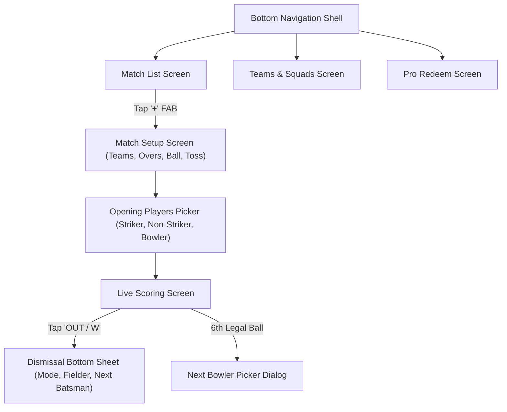

# Implementation Plan — Stage 2: Match Setup Flow, Dismissal Dialogs & App Shell

## Goal Description

Transition CricSaga from a single hardcoded match into a full, self-contained cricket app. Scorers will be able to:
1. **Start a New Match:** Select or enter Team A & Team B, select Overs (custom 1–50 or presets 5, 8, 10, 12, 15, 20), ball type (Tennis/Leather), and record the Toss winner & decision.
2. **Select Opening Players:** Choose Striker, Non-Striker, and Opening Bowler to kick off live play.
3. **Interactive Dismissal Dialog (CricHeroes Parity):** Tapping `OUT / W` opens a bottom sheet to select dismissal type (Caught, Bowled, Run Out, Stumped, LBW), assign the fielder for career stats, and pick the incoming batsman.
4. **End-of-Over Transition:** Automatically prompt to select the next bowler after the 6th legal delivery (enforcing cricket's rule that a bowler cannot bowl two consecutive overs).
5. **Pro Membership Redeem Screen:** A dedicated screen/dialog where users enter their 8–10 character Redeem Code to unlock Pro status.
6. **Bottom Navigation Shell:** A clean, bottom-navigation structure (Scoring / Matches, Teams, Pro Redeem, Profile).

---

## User Review Required

> [!IMPORTANT]
> **Fielder Attribution Flow:**
> In accordance with our locked decision for CricHeroes parity, when `Caught` or `Run Out` is selected, the dialog requires picking the fielder from the fielding team roster. This ensures fielding records (catches, run-outs) are properly credited.

> [!TIP]
> **Redeem Code System:**
> We will implement a client-side + Room entitlement model for Pro activation with offline code verification algorithm (plus backend sync readiness). Entering a valid code instantly badges the app as "PRO ACTIVE".

---

## Proposed Changes & File Architecture



---

### Component 1: Navigation & Navigation Compose Dependencies

#### [MODIFY] `gradle/libs.versions.toml` & `app/build.gradle.kts`
- Add `androidx.navigation:navigation-compose:2.8.0`.

---

### Component 2: Dialogs & Interaction Components (`app/src/main/java/com/cricsaga/app/ui/scoring/dialog/`)

#### [NEW] `DismissalBottomSheet.kt`
- Modal Bottom Sheet triggered by `OUT / W`:
  - Dismissal Type chips: `Caught`, `Bowled`, `Run Out`, `Stumped`, `LBW`, `Hit Wicket`.
  - If `Caught`: Dropdown to pick Catcher from fielding squad.
  - If `Run Out`: Radio buttons for who was dismissed (`Striker` vs `Non-Striker`), runs completed before run-out (`0, 1, 2`), and fielder(s).
  - Incoming Batsman selector: Displays remaining bench players.
  - Action button: `Confirm Wicket`.

#### [NEW] `BowlerSelectionDialog.kt`
- Triggered automatically on the 6th legal delivery of an over:
  - Displays bowling team squad.
  - Disables the bowler who just completed the over (cricket rule: no back-to-back overs).
  - Select new bowler and resume immediately.

---

### Component 3: Match Setup & Player Picker (`app/src/main/java/com/cricsaga/app/ui/setup/`)

#### [NEW] `MatchSetupScreen.kt`
- Form fields:
  - Team A & Team B names (or pick existing team from Room).
  - Overs preset chips (`5, 8, 10, 12, 15, 20, Custom`).
  - Ball Type selector (`Tennis Ball` vs `Leather Ball`).
  - Toss Winner & Elected to (`Bat` / `Bowl`).
  - Button: `Proceed to Squad & Openers`.

#### [NEW] `OpenersSelectionScreen.kt`
- Select `Striker`, `Non-Striker`, and `Opening Bowler`.
- Button: `Start Scoring Match`.

---

### Component 4: Pro Membership Redeem Screen (`app/src/main/java/com/cricsaga/app/ui/redeem/`)

#### [NEW] `RedeemCodeScreen.kt`
- Beautiful CricSaga Pro promotional banner (Gold/Amber & Crimson theme).
- Redeem Code input box (e.g. `CRIC-PRO-2026`).
- "Redeem Code" button with validation animation.
- Instant Pro badge activation with entitlement details.

---

### Component 5: App Shell & Root Navigation (`app/src/main/java/com/cricsaga/app/ui/navigation/`)

#### [NEW] `AppNavigation.kt`
- Sealed class `Screen` with routes:
  - `Matches`: List of active/past matches.
  - `MatchSetup`: Create match.
  - `LiveScoring`: The active match scoring interface.
  - `RedeemPro`: Redeem membership.
- Scaffold with bottom navigation bar:
  - Matches (`SportsCricket` / icon)
  - Pro Redeem (`Star` / icon)

---

## Verification Plan

### 1. Automated Unit Tests
- Add unit test in `ScoringEngineTest.kt` verifying back-to-back bowler restriction and multi-wicket fall.
- Run:
  ```bash
  ./gradlew testDebugUnitTest
  ```

### 2. Physical Device End-to-End Verification
- Build and stream APK to phone over Wi-Fi:
  ```bash
  ./gradlew assembleDebug
  adb install -r app/build/outputs/apk/debug/app-debug.apk
  ```
- **Manual Verification Steps on Phone:**
  1. Open app -> see Match List -> tap "+ Start Match".
  2. Enter Team A ("Mumbai Warriors") and Team B ("Delhi Tigers"), select 10 Overs, Tennis Ball, Toss won by Warriors who elected to Bat.
  3. Pick Rohit Sharma (Striker), Virat Kohli (Non-Striker), Jasprit Bumrah (Bowler) -> Tap "Start Match".
  4. Score 6 balls -> verify End-of-Over Bowler selection dialog pops up.
  5. Tap `OUT / W` -> verify Dismissal Sheet opens, select Caught by Surya -> verify wicket and incoming batsman.
  6. Tap "Redeem Pro" in navigation -> enter code -> verify Pro badge unlocks.

### 3. Git Commit
- Commit Stage 2 baseline with clean commit message.
